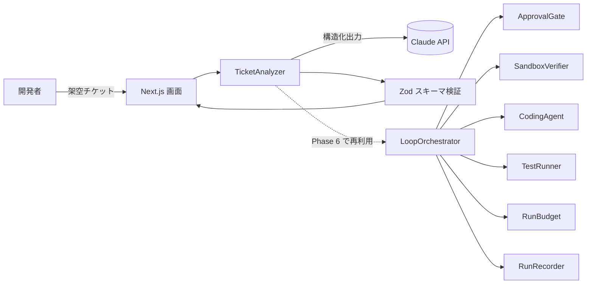
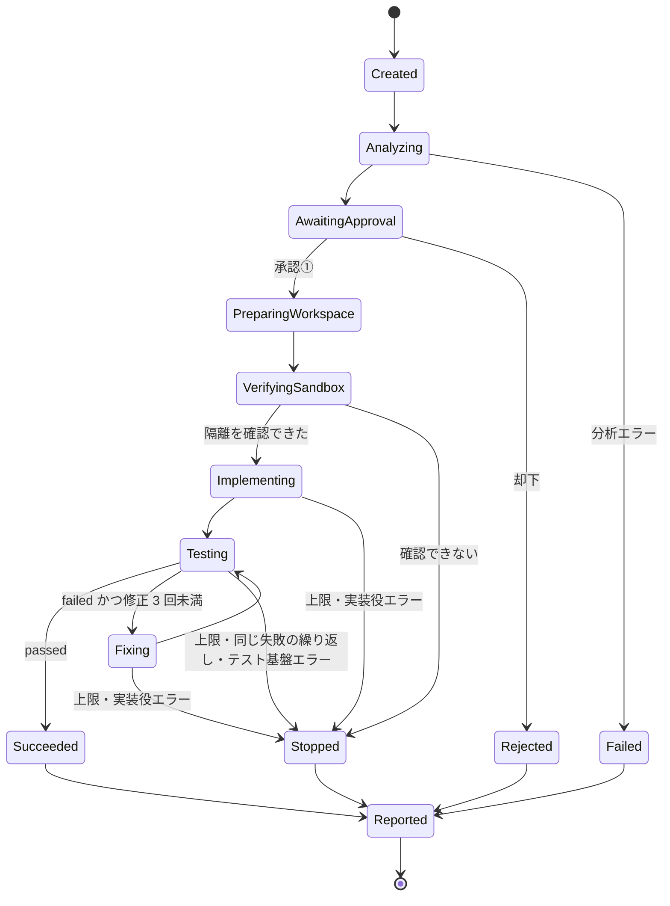

# AI Engineering Lab — AI Ticket Analyzer

> AI エージェントを「速く動かす」ことより、「安全に・止められる形で・検証しながら」動かすことを主題にした、AI エンジニアリングの設計・実践ポートフォリオです。

> [!IMPORTANT]
> **現在は設計段階です。** Phase 0（設計）が完了した段階で、**アプリケーションは Phase 1 以降すべて未実装**です。
> 本リポジトリに掲載している自律開発ループは**未完成**であり、本文中の安全設計・コンポーネント・上限値は「設計済み（未実装）」のものです。
> 各項目の実装状況は「[8. 現在の進捗](#8-現在の進捗)」の成熟度表を参照してください。

---

## 目次

1. [プロジェクト概要](#1-プロジェクト概要)
2. [解決したい課題](#2-解決したい課題)
3. [アーキテクチャ](#3-アーキテクチャ)
4. [Harness Engineering の設計](#4-harness-engineering-の設計)
5. [Loop Engineering の構想](#5-loop-engineering-の構想)
6. [安全性・承認ゲート](#6-安全性承認ゲート)
7. [技術スタック](#7-技術スタック)
8. [現在の進捗](#8-現在の進捗)
9. [今後のロードマップ](#9-今後のロードマップ)
10. [ポートフォリオとしての技術的な見どころ](#10-ポートフォリオとしての技術的な見どころ)
11. [ドキュメント一覧](#11-ドキュメント一覧)

---

## 1. プロジェクト概要

**AI Ticket Analyzer** は、ソフトウェア開発のチケット（要件・不具合報告など）を入力すると、LLM が分析して次の 6 項目を構造化データ（JSON）で返す Web アプリケーションとして**設計**しています。

| # | 出力項目 | 内容 |
|---|---|---|
| 1 | 要求の整理 | 何をしたいのか・受入条件の候補 |
| 2 | 不明点の抽出 | 実装前に確認すべき質問 |
| 3 | 影響範囲の推定 | 画面・API・DB・外部連携など |
| 4 | テスト観点 | 正常系・異常系・境界値 |
| 5 | 工数見積もりの補助 | 作業分解と幅のある見積もり |
| 6 | リスクの整理 | 技術・仕様・運用リスクと対策案 |

位置付けは「AI が答えを出す」ではなく、**「人がチケットを詰めるための叩き台を出す」**ことです。見積もりは確定値ではなく補助情報として扱います。

最終目標（Phase 6）は、このチケット分析を最初の工程として再利用する**ローカル自律開発ループ**です。架空のチケットを入力すると、分析 → 人の承認 → 実装 → テスト → 失敗時の修正 → 結果・差分・費用の整理 → 人の最終確認、までを進める構想です。

単なる「コーディングエージェントの自動実行ツール」ではなく、**制御・安全性・評価・費用管理をアプリケーション側で実装し、その設計理由を説明できること**を重視しています。

> 扱うデータはすべて架空のチケットとダミーリポジトリです。実在の企業・個人・業務データは使用しません。サンプルは [examples/fixtures/tickets.sample.jsonl](examples/fixtures/tickets.sample.jsonl) を参照してください。

## 2. 解決したい課題

| 課題 | 本プロジェクトでの扱い（設計） |
|---|---|
| チケットの曖昧さが、実装後の手戻りになる | 不明点・影響範囲・テスト観点を実装前に洗い出す叩き台を出す |
| LLM の出力形式が不安定で、アプリに組み込みにくい | Zod スキーマを単一の正（SSOT）とし、構造化出力と型でつなぐ |
| 「なんとなく良くなった」で品質を判断してしまう | 固定データセットと 3 層の評価で、基準値との差分を数値で残す |
| AI エージェントに権限を渡すと、止め方・範囲が曖昧になる | ワークフローの制御権を AI に渡さず、状態遷移・上限・停止理由をアプリ側で持つ |
| 「テストが通りました」という AI の自己申告を信じてしまう | テストの合否は、アプリがコマンドを実行して終了コードで独立に判定する |
| 自律実行による費用の暴走 | 1 実行・1 日・1 か月の費用上限を多層で強制する |

## 3. アーキテクチャ

> **以下は設計上の構成です。図・表のコンポーネントはすべて未実装です。**

### 3.1 全体像（設計）

### 3.2 主要コンポーネント

| コンポーネント | 責務 | 実装状態 |
|---|---|---|
| `TicketAnalyzer` | チケットを分析し、6 項目の構造化出力を返す | 📝 設計段階（Phase 1 で実装予定） |
| `LoopOrchestrator` | 自律開発ループの状態遷移を管理する。遷移表にない遷移は例外にする | 📝 設計段階（Phase 6 MVP で実装予定） |
| `ApprovalGate` | 人の承認①（開始前）と承認②（終了後）を扱う | 📝 設計段階（Phase 6 MVP で実装予定） |
| `SandboxVerifier` | 実装役を起動する前に、OS レベルの隔離が実際に効いているかを確認する | 📝 設計段階（Phase 6 MVP で実装予定） |
| `CodingAgent` | 使い捨ての作業ディレクトリ内で、1 回の実装・修正だけを担当する | 📝 設計段階（Phase 6 MVP で実装予定） |
| `TestRunner` | テストを実際に実行し、終了コードで合否を判定する | 📝 設計段階（Phase 6 MVP で実装予定） |
| `RetryController` | 修正回数・同じ失敗の繰り返しを管理する | 📝 設計段階（Phase 6 MVP で実装予定） |
| `RunBudget` | 1 実行・1 日・1 か月の費用上限を管理する | 📝 設計段階（Phase 6 MVP で実装予定） |
| `RunRecorder` | 実行履歴・停止理由・差分・費用を記録する | 📝 設計段階（Phase 6 MVP で実装予定） |

**設計原則:** AI エージェントの SDK には「1 回の実装・修正」だけを任せます。ワークフロー全体の制御（いつ止めるか、次に何をするか）は渡しません。

詳細: [docs/architecture.md](docs/architecture.md)

## 4. Harness Engineering の設計

> **設計段階（未実装）です。**

Harness Engineering は、AI が動く環境・権限・検証手順・停止条件を整える設計です。本プロジェクトでは **fail closed**（判定できない・異常時は許可せず拒否する）を基本方針にしています。

### 4.1 書き込みを許す条件（S-1〜S-10）

Phase 6 で実装役にファイル書き込みとコマンド実行を許すのは、**次のすべてを満たす場合だけ**です。1 つでも満たせなければ、実装役を起動しません。

| # | 条件 |
|---|---|
| S-1 | 対象は架空チケットと、本プロジェクトで作ったダミーリポジトリだけ |
| S-2 | 作業場所は、本体リポジトリの外にある実行ごとの使い捨てディレクトリ |
| S-3 | SDK の権限制御だけを根拠にせず、OS レベルの隔離（sandbox またはコンテナ）を必ず組み合わせる |
| S-4 | 起動前に、隔離が実際に効いていることを確認する（`SandboxVerifier`） |
| S-5 | 実装役に渡す環境変数は必要最小限にする |
| S-6 | 外部ネットワーク接続は原則禁止。LLM API への通信だけを例外とする |
| S-7 | 実行できるコマンドは許可リスト方式。push・PR 作成・デプロイ・破壊的操作は対象外 |
| S-8 | 人の承認ポイントを 2 つ置く。成果を自動で本体へ取り込まない |
| S-9 | 実行時間・費用・ターン数・修正回数の上限を、アプリ側で必ず強制する |
| S-10 | 利用者や本体リポジトリのエージェント設定を、実装役に読み込ませない |

### 4.2 SandboxVerifier（起動前の隔離確認）

「隔離を設定した」ことではなく、**「禁止した操作が実際に失敗する」こと**を、起動のたびに確認する設計です。

| # | 実際に試して「失敗すること」を確認する操作 |
|---|---|
| V-1 | 作業場所の外へのファイル書き込み（ツール経由・シェルのリダイレクト・ファイルコピーのすべて） |
| V-2 | ホームディレクトリの秘密情報の置き場所の読み取り |
| V-3 | 許可していない外部ネットワークへの接続 |
| V-4 | 作業場所の外のファイルの削除 |

1 つでも成功してしまった場合（＝隔離が効いていない場合）は、`SANDBOX_UNVERIFIED` で停止します。隔離が使えない環境で、隔離なしの実行に切り替えることもしません。

### 4.3 多層の制御

| 層 | 内容 |
|---|---|
| コマンド | 許可リスト ＋ 拒否ルール ＋ hooks による拒否を重ねる。全自動承認モードは使わない |
| 秘密情報 | 環境変数を明示的に最小化し、エージェント設定の読み込みを無効化する。記録時は秘密情報らしき文字列をマスクする |
| ネットワーク | 外部接続は原則禁止。Web 取得・検索ツールは使わせない |
| 上限 | 下表の値をアプリ側で強制する |

| 上限 | 初期値 | 強制する場所 |
|---|---|---|
| 修正回数 | 最大 3 回（初回の実装は数えない） | `RetryController` |
| 1 回の実装・修正のターン数 | 30 ターン | SDK の最大ターン数 |
| 1 回の実装・修正の時間 | 10 分 | 中断シグナル（`AbortSignal`） |
| 1 回のテスト実行の時間 | 2 分 | `TestRunner` |
| 1 実行全体の時間 | 30 分 | `LoopOrchestrator` |
| 費用 | 1 実行 $1（目標）/ 1 日 $3 / 1 か月 $10 | `RunBudget` |

> 費用上限はアプリ側で止めるための目標値であり、請求額の厳密な上限を保証するものではありません。SDK が返す費用はクライアント側の推定値のため、上限との間に余裕を持たせます。また、セッションを再開した場合は累計値が返るため、前回との差分で計上します。

詳細: [docs/harness-engineering.md](docs/harness-engineering.md)

## 5. Loop Engineering の構想

> **自律開発ループは未完成です（設計段階・未実装）。**

### 5.1 工程と MVP の範囲

最終形は 12 工程です。MVP（最初に作る最小構成）では、AI による調査・計画・コードレビュー・PR 本文の生成を除いた工程から作る計画です。

| # | 工程 | MVP |
|---|---|---|
| 1 | チケット分析 | ○ |
| 2 | 既存コード・仕様の調査 | × 将来 |
| 3 | 実装計画の作成 | △ 分析結果をそのまま指示にする |
| 4 | 人による実装承認（承認①） | ○ |
| 5 | コード実装 | ○ |
| 6 | テスト実行 | ○ |
| 7 | テスト失敗時の自動修正 | ○ 最大 3 回 |
| 8 | AI コードレビュー | × 将来 |
| 9 | レビュー指摘に基づく修正 | × 将来 |
| 10 | 実行結果・差分・費用の整理 | ○ |
| 11 | PR 本文の生成 | × 将来 |
| 12 | 人による最終確認（承認②） | ○ |

### 5.2 状態遷移（設計）

（図を見やすくするため、各状態から `Cancelled`（利用者による中断）への遷移は省略しています。）

- 遷移は遷移表でだけ許可し、表にない遷移は例外にします。
- どの終了状態でも必ず `Reported` を通り、実行履歴と停止理由を残します。

### 5.3 停止理由（StopReason）

止まった理由を 12 種類に分けて記録し、「なぜ止まったか」を後から評価できるようにします。

| 区分 | 停止理由 |
|---|---|
| 成功 | `TESTS_PASSED` |
| 上限 | `MAX_FIX_ATTEMPTS` / `BUDGET_EXCEEDED` / `TIMEOUT` / `MAX_TURNS` |
| 改善の見込みなし | `REPEATED_FAILURE`（同じテストが同じ理由で 2 回続けて失敗） |
| 人の判断 | `USER_CANCELLED` / `APPROVAL_REJECTED` |
| 安全・異常 | `SANDBOX_UNVERIFIED` / `AGENT_ERROR` / `TEST_INFRA_ERROR` / `ANALYSIS_ERROR` |

### 5.4 修正ループの規則（設計）

- テストの合否は `TestRunner` が終了コードで判定します。AI の「テストが通った」という自己申告は根拠にしません。
- `passed` だけを成功とし、`not_run` / `error` / `timeout` は成功にしません。
- 次の修正の前に残り予算を確認し、1 回分に満たなければ停止します。
- テスト基盤の異常は、修正では直らないため修正せずに停止します。

### 5.5 現在のレビュー・修正の運用（手動）

自律ループとは別に、現在は**人が介在するレビュー・修正ループ**を、ChatGPT と Claude Code を使って手動で運用しています。

| 役割 | 担当 |
|---|---|
| 全体設計・技術レビュー・方針判断 | ChatGPT |
| ローカルでの調査・設計書作成・（今後）実装とテスト | Claude Code |
| 最終承認・公開判断・API キーと課金の管理 | 開発者（人） |

各作業の報告は、次の 3 段階で判定しています。

| 判定 | 意味 |
|---|---|
| **PASS** | 完了条件をすべて満たした |
| **PARTIAL** | 一部を達成し、残課題を明記して人の判断へ回す |
| **BLOCKED** | 権限・情報不足・安全上の理由で、これ以上進めない |

> この判定は**現在の手動レビュー運用で使っているもの**です。本リポジトリ・アプリケーションには実装も定義もしておらず、Phase 6 の `StopReason` との対応付けは今後の設計課題です。

詳細: [docs/loop-engineering.md](docs/loop-engineering.md) / [docs/agentic-workflow.md](docs/agentic-workflow.md)

## 6. 安全性・承認ゲート

> **設計段階（未実装）です。**

### 6.1 人による承認は 2 回

| 承認 | タイミング | 確認すること |
|---|---|---|
| 承認① | 実行開始前 | 分析結果・対象のダミーリポジトリ・予算・上限 |
| 承認② | 実行終了後 | 差分・テスト結果・停止理由・費用 |

- MVP では、成果を本体リポジトリへ自動で取り込む機能そのものを作りません。
- アプリの実装役は、push・PR 作成・デプロイを行いません。

### 6.2 データとセキュリティの方針

- 使用するのは架空のチケットとダミーリポジトリだけです。実在の企業・個人・業務データは扱いません。
- API キーは環境変数で管理し、リポジトリにはダミー値の `.env.example` だけを置く方針です（実装開始時に追加）。
- 評価データには、プロンプトインジェクションを含む「意地悪なケース」を含め、耐性を測ります。
- AI エージェントの実行権限は最小限から始め、広げる場合は ADR で判断を残します。

### 6.3 Context Engineering（AI への情報の渡し方）

- `CLAUDE.md` には「目的・参照先・守るルール」だけを短く書き、詳細は設計書へ委ねます。
- 会話履歴はスレッド間で共有されない前提で、判断はリポジトリ内の Markdown（設計書・ADR・引き継ぎ資料）に残します。
- 設計判断は ADR（Architecture Decision Record）として、作成 → AI によるレビュー → 人の承認、の順で確定します。未確認の事項は、確定した事項として扱いません。
- 作業はスレッド（役割）ごとに分けます（設計ドキュメント / 実装 / テスト・評価 / 調査・セキュリティ）。テスト・評価のスレッドは、実装から独立して検証します。

詳細: [docs/security.md](docs/security.md) / [docs/context-engineering.md](docs/context-engineering.md) / [SECURITY.md](SECURITY.md)

## 7. 技術スタック

> 設計時点の選定です。バージョンは実装時に再確認します。

| 層 | 採用（予定） |
|---|---|
| 言語・画面 | TypeScript ＋ Next.js（App Router）＋ React |
| チケット分析の LLM | Claude API（Messages API ＋ 構造化出力） |
| LLM SDK | `@anthropic-ai/sdk` |
| 自律開発ループ（Phase 6） | Claude Agent SDK |
| スキーマ・検証 | Zod（出力スキーマの単一の正） |
| テスト | Vitest / Playwright |
| パッケージ管理 | pnpm |
| モデル | 設定で切り替え（コードに直接書かない）。評価結果で選定 |

### Evaluation Engineering（評価設計）

評価は、安くて確実なものから順に 3 層で積み上げる設計です。

| 層 | 内容 | 主な指標 |
|---|---|---|
| ① 機械的チェック | 無料・決定的 | スキーマ適合率（再試行込みで 98% 以上）、必須項目の充足、見積もりの整合 |
| ② 参照データとの照合 | 無料・決定的 | 影響範囲の再現率、不明点のキーワード網羅、禁止内容の混入率（0% 目標）、インジェクション耐性 |
| ③ LLM による採点 | 有料・確率的 | 具体性・妥当性・有用性（1〜5 点）。人手採点との一致度も確認する |

- データセット: 架空チケット 20 件（Phase 1）→ 50〜100 件（Phase 4）。意地悪ケースを 10〜20% 含めます。
- 評価結果はファイルとして Git 管理し、「改善した証拠」を差分で示します。
- Phase 6 の評価では、受入テストを実装役に見せません。

詳細: [docs/tech-stack.md](docs/tech-stack.md) / [docs/evaluation.md](docs/evaluation.md)

## 8. 現在の進捗

凡例: ✅ 完了 / 🔄 運用中（手動） / 📝 設計段階（未実装） / 💭 構想

| 項目 | 状態 | 補足 |
|---|---|---|
| Phase 0: 要件・アーキテクチャ・セキュリティ・評価の設計 | ✅ 完了 | 設計書と ADR |
| ADR による設計判断の記録 | ✅ 完了 | 自律開発ループの方式、SDK の選定 |
| ChatGPT と Claude Code の役割分担によるレビュー運用 | 🔄 運用中 | PASS / PARTIAL / BLOCKED で判定（アプリへの実装はなし） |
| AI エージェント作業時の作業ディレクトリ分離ルール | 🔄 運用中 | 個人の開発運用ルール |
| Phase 1: チケット分析（LLM API 連携） | 📝 設計段階 | 未実装 |
| 評価（3 層の Evals） | 📝 設計段階 | 未実装。評価データはサンプル数件のみ |
| Phase 6: 自律開発ループ（MVP） | 📝 設計段階 | **未完成・未実装**。状態遷移・停止理由・上限・隔離確認を設計済み |
| AI コードレビュー・調査・計画の自動化 | 💭 構想 | Phase 6 の拡張 |

> **アプリケーションのコードは、まだ含まれていません。** 実装は Phase 1 から順に追加していきます。

## 9. 今後のロードマップ

**最初の実装は、Mock LLM（費用 0）を使った Phase 1 の試作です。**

実施順は Phase 1 → 6（MVP）→ 2 → 3 → 4 → 5 です。

| 順 | Phase | 内容 |
|---|---|---|
| 1 | Phase 1 | LLM API 連携。Mock LLM での試作から始め、チケット分析、構造化出力、エラー・再試行、評価の基準値の取得 |
| 2 | Phase 6 MVP | 自律開発ループ。承認ゲート、隔離確認、テスト判定、修正ループ、費用上限 |
| 3 | Phase 2 | RAG（出典付きの回答） |
| 4 | Phase 3 | 読み取り専用のエージェント（ツール呼び出し） |
| 5 | Phase 4 | 評価の高度化（データセットの拡充、LLM による採点の本格化） |
| 6 | Phase 5 | 公開品質の整備：起動手順、デモ、評価結果の掲載 |

> 設計資料は Phase 0 完了時点で先行公開しています。Phase 5 では、アプリを clone して Mock LLM で起動できる状態に整えます。

詳細: [docs/roadmap.md](docs/roadmap.md)

## 10. ポートフォリオとしての技術的な見どころ

1. **AI に制御権を渡さない設計** — エージェントには「1 回の実装・修正」だけを任せ、状態遷移・停止判断・上限はアプリ側の遷移表と型で持ちます。
2. **fail closed の安全設計** — 書き込みを許す 10 条件のうち 1 つでも欠ければ起動しません。権限設定を信じるのではなく、`SandboxVerifier` で「禁止した操作が実際に失敗すること」を起動のたびに確かめます。
3. **自己申告に頼らない検証** — テストの合否は終了コードで独立に判定し、`not_run` や `timeout` を成功扱いにしません。
4. **止まり方の設計** — 12 種類の停止理由で「なぜ止まったか」を記録し、同じ失敗の繰り返しや予算不足を、上限に達する前に検知します。
5. **費用管理の現実的な扱い** — SDK の費用は推定値であること、セッション再開時の二重計上を考慮し、多層の上限を設けます。
6. **評価駆動の改善** — 安価で決定的な評価から積み上げ、評価結果を Git の差分として残します。
7. **人と AI の分業の明文化** — 設計レビュー（ChatGPT）、実装・調査（Claude Code）、承認（人）の責務を分け、判断の経緯を ADR に残します。
8. **正直な成熟度の表示** — 完了・運用中・設計段階・構想を区別し、未実装のものを実装済みとは書きません。

## 11. ドキュメント一覧

| ドキュメント | 内容 |
|---|---|
| [docs/README.md](docs/README.md) | ドキュメントの目次と読む順番 |
| [docs/requirements.md](docs/requirements.md) | 要件 |
| [docs/architecture.md](docs/architecture.md) | アーキテクチャ |
| [docs/tech-stack.md](docs/tech-stack.md) | 技術選定 |
| [docs/security.md](docs/security.md) | セキュリティ設計 |
| [docs/harness-engineering.md](docs/harness-engineering.md) | Harness Engineering |
| [docs/loop-engineering.md](docs/loop-engineering.md) | Loop Engineering（自律開発ループ） |
| [docs/evaluation.md](docs/evaluation.md) | 評価計画 |
| [docs/roadmap.md](docs/roadmap.md) | ロードマップ |
| [docs/context-engineering.md](docs/context-engineering.md) | Context Engineering |
| [docs/agentic-workflow.md](docs/agentic-workflow.md) | AI と人の分業・レビュー運用 |
| [docs/adr/README.md](docs/adr/README.md) | 設計判断の記録（ADR） |

---

## ライセンス

[MIT License](LICENSE)
