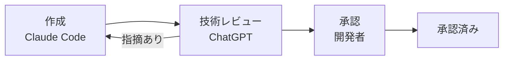

# 設計判断の記録（ADR: Architecture Decision Record）

> **状態:** Phase 0 の設計判断。記録した方式はいずれも未実装です。

設計上の重要な判断と、その理由・検討した選択肢・残った未確認事項を残します。
会話の履歴は後から参照できない前提で、判断の根拠をリポジトリの中に残すことが目的です。

## 1. 承認の流れ

1. 設計ドキュメントを担当するスレッドが ADR を作成する
2. ChatGPT が技術レビューを行い、指摘があれば修正する
3. 開発者が承認する

## 2. 運用ルール

- 承認済みの ADR でも、「未確認事項」に残した技術的な事項は**確定していない**ものとして扱う。
- 設計書の内容を ADR で変更した場合は、設計書側にも変更理由と ADR へのリンクを残す。
- 判断を覆す場合は、既存の ADR を書き換えず、新しい ADR で置き換える。

## 3. 一覧

| ADR | タイトル | 状態 |
|---|---|---|
| [ADR-0001](./ADR-0001-autonomous-development-loop.md) | 自律開発ループの方式（アプリ側で制御し、書き込みは条件付きで許可） | 承認済み（未確認事項あり） |
| [ADR-0002](./ADR-0002-claude-agent-sdk.md) | アプリ内部の LLM を Claude に統一し、Claude Agent SDK を使う | 承認済み（未確認事項あり） |

関連: [docs の目次](../README.md) / [リポジトリの README](../../README.md)
