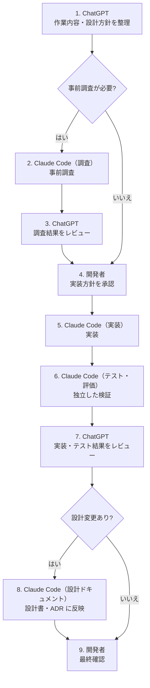

# Agentic Workflow — AI と人の分業

| 項目 | 内容 |
|---|---|
| 状態 | **運用中（手動）**の開発プロセス。アプリの機能ではない |
| 対象 | 本プロジェクトの設計・調査・実装・レビューを、複数の AI と人で分担する進め方 |
| 関連 | [Context Engineering](./context-engineering.md) / [ロードマップ](./roadmap.md) / [Loop Engineering](./loop-engineering.md) |

> この文書は、**現在の開発の進め方**を説明するものです。アプリケーションに組み込む自律開発ループ（[Loop Engineering](./loop-engineering.md)）とは別物です。
> 本プロジェクトは Phase 0（設計）を完了した段階で、アプリケーションのコードはまだありません。

---

## 1. 役割分担

| 担当 | 役割 |
|---|---|
| **ChatGPT** | 全体の司令塔・技術レビュー役。開発方針とアーキテクチャのレビュー、技術選定の妥当性確認、Claude Code への作業指示の整理、調査・実装・テスト結果のレビュー、Phase の着手・完了判断の支援、リスクと未決定事項の整理 |
| **Claude Code** | 調査・設計書作成・（今後）実装とテストの担当。作業前に既存の設計書と決定事項を確認し、担当範囲の中で作業し、結果を報告し、必要な情報をリポジトリに記録する |
| **開発者（人）** | 最終判断・承認。設計と技術選定の最終承認、作業範囲の承認、API キーの発行と課金設定、公開範囲の変更、デプロイ、最終的な動作確認 |

- ChatGPT はアプリの**外**にいるレビュー役です。アプリの内部で使う LLM（Claude）とは別の役割で、アプリに OpenAI API は組み込みません。
- **権限と費用に関わる操作**（API キー・課金・公開範囲の変更・デプロイ）は、開発者だけが行います。

## 2. 実装とレビューの流れ

| 手順 | 担当 | 内容 |
|---|---|---|
| 1 | ChatGPT | 作業内容と設計方針を整理する |
| 2 | Claude Code（調査） | 必要なときだけ事前調査をする |
| 3 | ChatGPT | 調査結果をレビューする |
| 4 | 開発者 | 実装方針を承認する |
| 5 | Claude Code（実装） | 実装する |
| 6 | Claude Code（テスト・評価） | 実装とは独立した立場で検証する |
| 7 | ChatGPT | 実装結果とテスト結果をレビューする |
| 8 | Claude Code（設計ドキュメント） | 必要な設計変更を設計書・ADR に反映する |
| 9 | 開発者 | 最終確認をする |

軽微な作業では、一部の手順を省きます。役割の分け方は [Context Engineering](./context-engineering.md) を参照してください。

現在（Phase 0 完了時点）は、この流れを**設計書と ADR の作成・レビュー**に使っています。手順 5〜6 の実装とテストは、Phase 1 から始まります。

## 3. 作業報告の判定：PASS / PARTIAL / BLOCKED

> **この判定は、現在の手動レビュー運用で使っているものです。**
> 本リポジトリやアプリケーションには、**実装も定義もしていません**。

Claude Code が作業を終えたとき、結果を次の 3 段階で報告し、ChatGPT のレビューと開発者の判断につなげます。

| 判定 | 意味 | 次の行動 |
|---|---|---|
| **PASS** | 依頼の完了条件をすべて満たした | ChatGPT がレビューし、開発者が承認する |
| **PARTIAL** | 一部を達成したが、残課題がある。残課題と理由を明記する | 残課題を人が判断し、追加の指示を出すか、範囲を見直す |
| **BLOCKED** | 権限の不足・情報の不足・安全上の理由で、これ以上進めない | 止まった理由を人が確認し、判断・承認・情報を補う |

運用上の決まり：

- 実行していないテストや検証を、PASS の根拠にしません。
- 完了条件の一部でも満たしていない場合は、PASS ではなく PARTIAL と報告します。
- 安全上の判断が必要な場合は、作業を進めずに BLOCKED として人の判断を待ちます。

### 今後の設計課題

Phase 6 の自律開発ループでは、止まった理由を `StopReason`（12 種類）として記録します（[Loop Engineering](./loop-engineering.md)）。手動運用の PASS / PARTIAL / BLOCKED と `StopReason` をどう対応付けるかは、**今後の設計課題**です。現時点では対応付けを決めていません。

## 4. Phase 移行の承認

### 4.1 移行前に確認すること

各 Phase を始める前に、次を確認します。

- [ ] 前の Phase の完了条件（[ロードマップ](./roadmap.md)）を満たしているか
- [ ] 未解決の不具合
- [ ] 技術的負債
- [ ] 費用・セキュリティ上の懸念（[セキュリティ設計](./security.md)）
- [ ] 次の Phase の実装範囲
- [ ] 設計書を更新する必要があるか

### 4.2 承認

- **Phase の移行は自動では行わず、必ず開発者の承認を得ます。**
- 移行によって設計判断が変わる場合は ADR を作ります（[ADR 一覧](./adr/README.md)）。
- 実際の LLM API・エージェント SDK を使う実行は、そのたびに開発者の承認を得ます。承認がない間は Mock で開発・テストします。

## 5. この分業で狙っていること

| 狙い | 仕組み |
|---|---|
| 判断の偏りを減らす | 設計・実装をする AI と、レビューをする AI を分ける |
| 自己申告をうのみにしない | 実装と検証を別の役割に分け、判定の根拠を求める |
| 権限と費用の責任を人に置く | API キー・課金・公開・デプロイは開発者だけが行う |
| 判断の経緯を残す | 重要な判断は ADR に記録し、会話履歴に頼らない |
