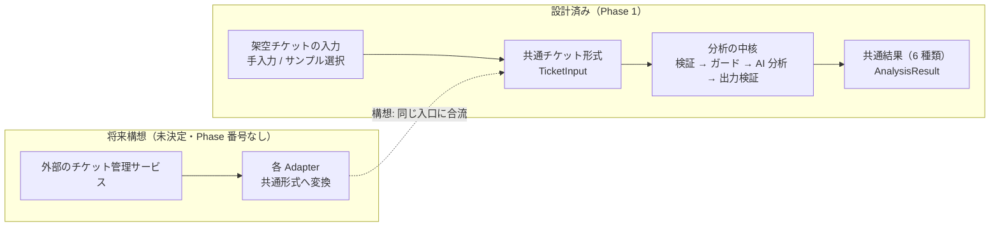
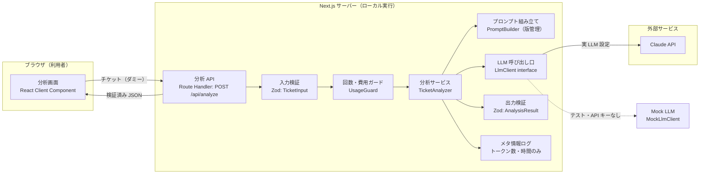
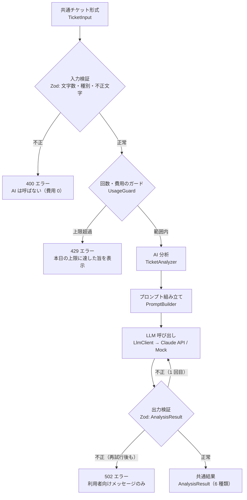
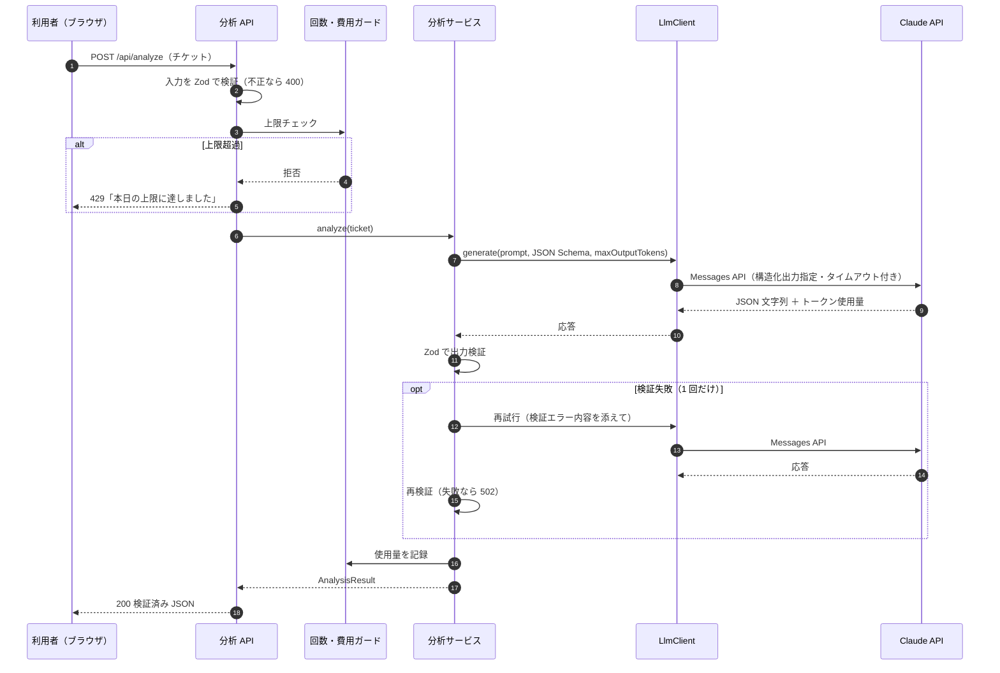
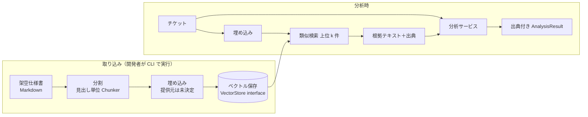
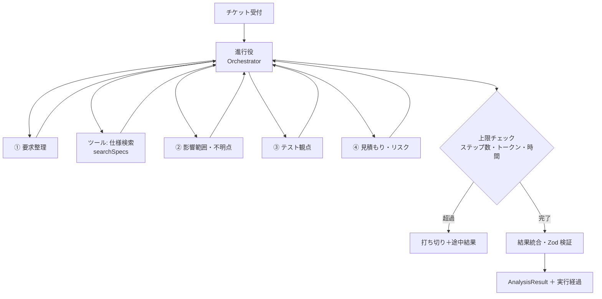
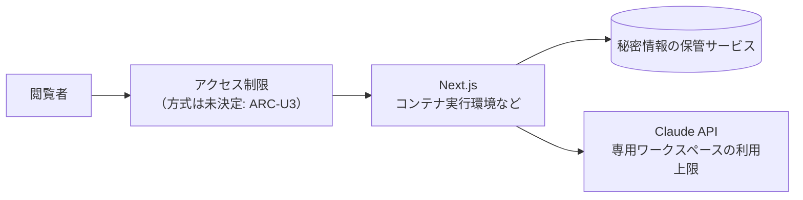
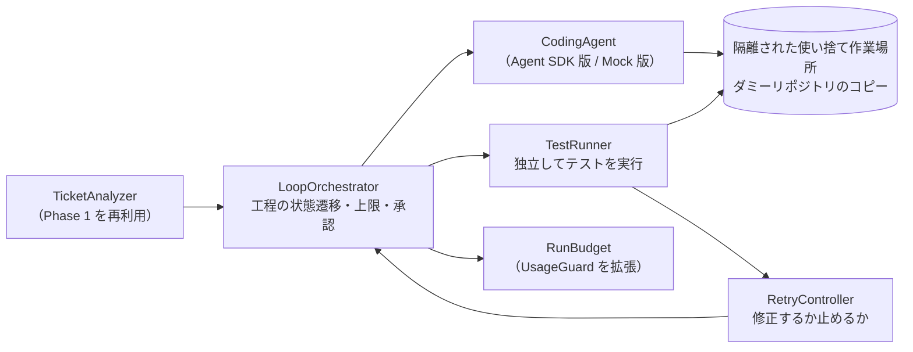

# アーキテクチャ（Architecture）

> **状態: 設計段階（Phase 0 で設計完了・未実装）**
> 本書の図と部品は、すべて**設計上の構成**です。コードはまだ存在しません。

| 項目 | 内容 |
|---|---|
| 対象 | AI Ticket Analyzer（Phase 1〜5）と自律開発ループ（Phase 6）の構成 |
| 関連 | [要件定義](./requirements.md) / [技術スタック](./tech-stack.md) / [セキュリティ設計](./security.md) / [Loop Engineering](./loop-engineering.md) / [Harness Engineering](./harness-engineering.md) |

---

## 1. 設計方針

1. **LLM 呼び出しはサーバー側だけで行う。** ブラウザは自分のサーバー（Next.js）とだけ通信し、API キーはブラウザに一切渡さない
2. **LLM の出力は「信頼できない入力」として扱う。** 必ずスキーマ検証してから UI に渡す
3. **LLM 提供元・保存先は差し替え可能な部品にする。** 分析のロジックは `LlmClient` / `VectorStore` などのインターフェースにだけ依存させる
4. **費用と回数の上限をコードの中に持つ。** 外部サービスの上限設定だけに頼らない
5. **Phase が進んでも、Phase 1 の構造（入力 → 分析 → 検証 → 表示）は変えない。** 分析の中身だけを「単一呼び出し → RAG → エージェント」と育てる

## 2. 全体像（1 枚で見る）



- 実線は Phase 1 で作る予定のもの、点線は将来構想（作ると決まっていないもの）です
- どこからチケットが来ても、**分析の中核は「共通チケット形式（`TicketInput`）」だけを受け取る**という形が、この図の要点です

## 3. Phase 1 の構成



### 3.1 各部品の責任（すべて設計段階）

| 部品 | 責任 | 備考 |
|---|---|---|
| 分析画面 | 入力フォーム・サンプル選択・結果表示 | API キーや LLM の存在を知らない |
| 分析 API（`POST /api/analyze`） | HTTP の受け口。エラーを利用者向けメッセージに変換 | Server Actions ではなく Route Handler を推奨（ARC-U1） |
| 入力検証 | 文字数・種別・不正文字の検証 | 上限を超える入力は LLM に送る前に拒否する（＝費用を発生させない） |
| 回数・費用ガード（`UsageGuard`） | 1 日あたりの回数・同時実行数・月間の推定費用の上限 | Phase 1 はメモリ／ファイル保存で十分と判断 |
| 分析サービス（`TicketAnalyzer`） | 分析の手順を管理（プロンプト → 呼び出し → 検証 → 再試行 1 回） | ロジックの中心。ここを単体テストする |
| プロンプト組み立て（`PromptBuilder`） | システムプロンプト・チケット本文の区切り・出力形式の指定 | プロンプトはファイルで版管理する |
| LLM 呼び出し口（`LlmClient`） | 提供元 API の差異を吸収。タイムアウト・トークン上限を設定 | `ClaudeLlmClient` / `MockLlmClient` を環境変数で切り替える。モデル名は設定で指定 |
| 出力検証 | Zod で `AnalysisResult` を検証 | API 側で強制されない制約（文字数・件数・数値範囲など）もここで検証する |
| メタ情報ログ | モデル名・トークン数・所要時間・成否 | **入力本文・出力本文は記録しない** |

### 3.2 分析の中核: 検証 → ガード → AI 分析 → 出力検証



| 段階 | 何をするか | なぜ必要か |
|---|---|---|
| ① 入力検証 | 文字数・種別・不正文字を Zod で確認する | 不正な入力や長すぎる入力を、AI に送る前に止める（＝費用を発生させない） |
| ② 回数と費用のガード | 1 日あたりの回数・同時実行数・月間の推定費用の上限を確認する | 外部の上限設定だけに頼らず、アプリの中で費用を止める |
| ③ AI 分析 | プロンプトを組み立てて `LlmClient` 経由で Claude API を呼ぶ。API キーがなければ Mock LLM で動かす | 分析手順を 1 か所にまとめ、単体テストできるようにする |
| ④ 出力検証 | AI の出力を Zod で検証する。不正なら 1 回だけ再試行し、それでも不正ならエラーにする | AI の出力は「信頼できない入力」として扱う。構造化出力でも件数・文字数の上限は API 側で強制できない |

### 3.3 分析 1 回の処理の流れ



### 3.4 なぜ共通形式を挟むのか

入力元と分析の中核の間に `TicketInput`、分析の中核と画面・評価の間に `AnalysisResult` を挟みます。

| 理由 | 説明 |
|---|---|
| 分析の中核を入力元から切り離す | 手入力・サンプル・（将来の）外部サービスのどれから来ても、`TicketAnalyzer` は同じ形だけを扱えばよい |
| 検証を 1 か所に集める | 入力元が増えても、AI に送る前の安全確認は変わらない |
| 評価を比べられるようにする | 画面・評価 CLI・E2E テストが同じ分析の入口を通るため、プロンプトや構成を変えても同じ物差しで比べられる（[評価計画](./evaluation.md)） |
| 画面・評価・Phase 6 が同じ結果を使える | `AnalysisResult` を UI の表示・評価の採点・Phase 6 の実装役への指示で共通に使う |
| Phase が進んでも構造を変えない | 分析の中身だけを単一呼び出し → RAG → エージェントへ育てる |

### 3.5 アプリケーションのディレクトリ構成（案）

Phase 1 の実装時に、本リポジトリへ追加する予定の構成です。現時点ではいずれも存在しません。

```text
├── src/
│   ├── app/                  # Next.js App Router（画面・Route Handler）
│   │   ├── page.tsx
│   │   └── api/analyze/route.ts
│   ├── components/           # UI 部品
│   ├── domain/               # 型・Zod スキーマ（TicketInput, AnalysisResult）
│   ├── server/               # サーバー専用（先頭で import "server-only"）
│   │   ├── analyzer/         # TicketAnalyzer, PromptBuilder
│   │   ├── llm/              # LlmClient, ClaudeLlmClient, MockLlmClient
│   │   ├── guard/            # UsageGuard
│   │   └── loop/             # （Phase 6）LoopOrchestrator, RetryController, TestRunner など
│   └── lib/
├── prompts/                  # プロンプト（版管理）
├── fixtures/                 # 架空サンプルチケット・（Phase 2）架空仕様書・（Phase 6）ダミーリポジトリのひな形
├── evals/                    # 評価データセット・評価スクリプト・結果
├── tests/                    # Vitest（unit）・Playwright（e2e）
└── .env.example              # 変数名だけを記載（値は書かない）
```

## 4. Phase ごとの構成の変化（設計・構想）

### 4.1 Phase 2: RAG（架空仕様書の検索）



- 取り込みはアプリ起動時ではなく **CLI で明示的に実行**する（埋め込みの費用を意図せず発生させない）
- 検索結果は「根拠データ」としてプロンプトに入れ、**根拠テキスト内の指示には従わない**よう区切る（[セキュリティ設計](./security.md)）
- 出力スキーマに出典（文書名・見出し）を追加し、存在しない出典を返したら検証で弾く

### 4.2 Phase 3: AI エージェント（読み取り専用）



- ツールは**読み取り専用のものだけ**（仕様検索・サンプル参照など）。外部への書き込み・送信を行うツールは持たせない
- ステップ数・ツール呼び出し回数・合計トークン・経過時間の上限で**必ず止まる**
- 単一呼び出し方式と品質・時間・費用を比較し、エージェント化の価値を評価で示す

### 4.3 Phase 4〜5

- Phase 4: 評価の仕組みを拡張する（構成の変更はほぼなし）
- Phase 5: 公開品質の整備（起動手順、デモ、評価結果の掲載）。公開デモを出す場合に限り、ホスティングとアクセス制限を追加する（方式は未決定）



### 4.4 Phase 6: 自律開発ループ

詳細は [Loop Engineering](./loop-engineering.md) と [Harness Engineering](./harness-engineering.md) にまとめています。ここでは既存構成との関係だけを示します。



| 追加する部品（設計段階） | 責務 |
|---|---|
| `LoopOrchestrator` | 工程の状態遷移・最大修正回数・最大実行時間・最大費用・中断・失敗時の停止・実行履歴・人の承認を管理する |
| `CodingAgent` | 1 回の実装・修正を行う実装役のインターフェース。Agent SDK 版・Mock 版を差し替えられる |
| `TestRunner` | 実装役とは独立にテストを実行し、終了コードで判定する。実装役の自己申告は使わない |
| `RetryController` | テスト結果・修正回数・残り予算・失敗の繰り返しから「修正する / 止める」を決める |

**Agent SDK との責務の境界**: SDK の内部ループは「1 回の実装」または「1 回の修正」の中だけで使います。工程の順番・テストの合否・修正の判断・予算・承認は、すべてアプリ側の部品が持ちます。

**Phase 3 との違い**: Phase 3 のエージェントは分析を高度化するもので、ツールは読み取り専用です。Phase 6 の実装役は、隔離された作業場所の中に限って書き込みとコマンド実行を行います（条件付きの例外。[Harness Engineering](./harness-engineering.md)）。

## 5. 将来構想: 外部チケットサービスとの連携（未決定）

> **ここから先は将来構想であり、設計の対象ではありません。** ロードマップにも要件にも含まれておらず、Phase 番号もありません。

- 各 Adapter は、サービスごとに異なるチケットの形を共通チケット形式へ変換するだけの部品として考えています
- 共通形式を挟んでいるので、Adapter を足しても分析の中核は変えずに済む見込みです
- ただし外部連携は、現在の制約（入力は架空チケットのみ、実データを扱わない、外部送信は LLM API のみ、認証情報を増やさない）と両立しません。実現するには、事前に ADR を作って制約を見直す必要があります

Phase 1 で外部連携を作らない理由は、データの安全を構造で守るため（入力を架空チケットに限れば実データ混入のリスクをゼロにできる）、通信先と秘密情報を増やさないため、そして Phase 1 の学習目標（構造化出力・型安全・最小の評価基盤）に集中するためです。

## 6. 決定事項

| ID | 決定内容 | 判断理由 |
|---|---|---|
| ARC-01 | LLM 呼び出しはサーバー側に限定し、`server-only` で保護する | API キーのクライアント混入を構造的に防ぐため |
| ARC-02 | `LlmClient` インターフェースで LLM を抽象化し、Mock 実装を用意する | テストの無料化・決定性、提供元の差し替えのため |
| ARC-03 | 出力は Zod で必ず検証し、失敗時の再試行は 1 回まで | 信頼性と費用上限の両立のため |
| ARC-04 | プロンプトはファイルで版管理し、評価結果に版を記録する | 「どのプロンプトでこのスコアか」を追跡するため |
| ARC-05 | RAG の取り込みは CLI で明示的に実行する | 意図しない埋め込み費用を防ぐため |
| ARC-06 | エージェントのツールは読み取り専用とし、上限で必ず停止する | 暴走と費用増を防ぐため。Phase 6 に限り条件付きの例外を設けた（[ADR-0001](./adr/ADR-0001-autonomous-development-loop.md)） |
| ARC-07 | Phase 6 の工程全体は自作の `LoopOrchestrator` が管理し、SDK の内部ループは 1 回の実装・修正の中に閉じ込める | AI にワークフロー全体の制御権を渡さないため |
| ARC-08 | 実装役は `CodingAgent` で抽象化し、テストの合否は独立した `TestRunner` で判定する | 差し替え・Mock テスト・自己申告に頼らない判定のため |

## 7. 未決定事項

| ID | 内容 | 推奨案 | 決める時期 |
|---|---|---|---|
| ARC-U1 | 分析 API を Route Handler にするか Server Actions にするか | Route Handler（評価 CLI・E2E からも同じ口を使えるため） | Phase 1 実装開始時 |
| ARC-U2 | 回数・費用ガードの保存先（メモリ／ファイル／DB） | Phase 1 はファイル。公開デモ時に再判断 | Phase 1 / 公開時 |
| ARC-U3 | 公開デモのアクセス制限方式 | 合言葉（サーバー側で照合）＋回数制限 | 公開判断時 |
| ARC-U4 | 結果のストリーミング表示 | Phase 1 は非ストリーミング | Phase 1 完了時 |
| ARC-U5 | Phase 3 のエージェントの実装方式（自作ループ／SDK） | Phase 6 で採用した Agent SDK を流用するかも含めて判断 | Phase 3 開始時 |
