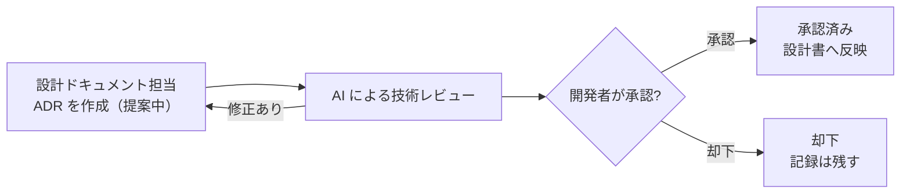

# Context Engineering — AI に渡す情報の設計

| 項目 | 内容 |
|---|---|
| 状態 | **設計段階の運用ルール**（AI コーディングエージェントを使った開発の進め方として定めたもの。アプリの機能ではない） |
| 対象 | 本プロジェクトを AI コーディングエージェント（Claude Code）と一緒に開発するときの、情報の渡し方・残し方 |
| 関連 | [Agentic Workflow](./agentic-workflow.md) / [ADR 一覧](./adr/README.md) / [CLAUDE.md](../CLAUDE.md) |

> 引き継ぎ資料（handoff）の**実例はまだありません**。この文書の該当部分は、テンプレートと運用の設計です。

---

## 1. 考え方

AI コーディングエージェントの出力の質は、「その作業に必要な情報を、必要な分だけ渡せているか」に大きく左右されます。本プロジェクトでは次の 4 つを方針にしています。

1. **常に読み込まれる指示は短く保つ**：`CLAUDE.md` には目的・参照先・守るルールだけを書き、詳細は設計書へ委ねる
2. **会話履歴は共有されない前提で設計する**：判断と経緯は、会話ではなくリポジトリ内の Markdown に残す
3. **役割ごとに作業を分ける**：1 つのセッションに全部を任せず、役割ごとに必要な情報だけを持たせる
4. **確定した事実と未確認の事項を分ける**：未確認のものは「未確認」と書き、確定扱いにしない

## 2. CLAUDE.md の設計

`CLAUDE.md` はエージェントが毎回読み込むファイルです。長くなると、重要なルールが埋もれ、読み込みの負担も増えます。

| 書くもの | 書かないもの |
|---|---|
| プロジェクトの目的（1〜2 行） | 設計の詳細（設計書へ） |
| 設計書・ADR の参照先 | 判断の経緯（ADR へ） |
| 役割ごとの責務と編集範囲 | 作業の手順書（各文書へ） |
| 守るルール（してよいこと・禁止） | 秘密情報・個人の環境に依存する値 |

本リポジトリの [CLAUDE.md](../CLAUDE.md) は、この方針で書いた公開用の最小版です。

## 3. 情報の置き場所

セッションをまたいで共有すべき情報は、すべてリポジトリ内の Markdown に記録します。

```text
docs/
├── *.md            # 決定済みの設計・方針（最新の正）
└── adr/
    ├── README.md   # ADR の書き方と一覧
    └── ADR-xxxx-*.md
```

| 置き場所 | 中身 | 更新のタイミング |
|---|---|---|
| 設計書（`docs/*.md`） | 現在の正しい設計 | 設計が変わったとき |
| ADR（`docs/adr/`） | なぜその設計にしたか | 重要な設計判断をしたとき |
| 引き継ぎ資料 | 作業の途中経過と次にやること | 下の 5 章の節目だけ |

## 4. 役割（スレッド）の分割と独立した検証

作業は、役割の違うセッション（スレッド）に分けます。1 つのセッションが設計・実装・検証をすべて担うと、自分の誤りに気づきにくくなるためです。

| 役割 | 担当すること | コードの編集 |
|---|---|---|
| 設計ドキュメント | 設計書・ADR の管理 | 原則しない |
| 実装 | アプリケーションの実装・修正、テストコード | 承認された範囲だけ |
| テスト・評価 | 実装とは**独立した立場**での検証・評価・観点漏れの指摘 | 原則読み取り専用 |
| 調査・セキュリティ | 公式仕様・料金・安全性の調査 | しない |

- 担当表は、ファイルを編集する権限を無条件に与えるものではありません。実際に変更してよいのは、各作業で承認された範囲だけです。
- 複数のセッションで同じファイルを同時に編集しません。
- Phase 6（自律開発ループ）のように書き込みを行うエージェントを扱う場面では、実装・調査・独立した検証をさらに明確に分けます。
- スレッドは必要な数だけにし、増やしすぎません。

### 作業ディレクトリの分離

並行して作業する場合は、**1 つの作業につき 1 つの作業ディレクトリ**（Git worktree）を使います。

- 別の作業の変更が混ざる事故を防ぐため
- テストやビルドの結果が、どの作業のものかを明確にするため
- 他の作業のディレクトリに対して、元に戻す・削除する・ビルドするといった操作をしないため

## 5. ADR と引き継ぎ資料の運用

### 5.1 ADR（Architecture Decision Record：設計判断記録）

「なぜその設計にしたか」を後から追えるようにする記録です。詳細は [ADR 一覧](./adr/README.md) を参照してください。



- ADR の中の**技術的な未確認事項は、承認済みになっても確定扱いにしません**。確認できたら追記します。
- 承認済みの ADR を変えるときは、新しい ADR を作り、古い ADR を「置き換え済み」にします。

### 5.2 引き継ぎ資料（テンプレート運用の設計）

小さな作業ごとには作りません。作るのは次の節目だけです。

- 重要な設計変更があったとき
- 担当する役割（スレッド）を切り替えるとき
- Phase を移行するとき
- 会話が長くなり、新しいセッションに移るとき

記録する項目は次のとおりです。

| 項目 | 内容 |
|---|---|
| 作業対象 | 何の作業か（Phase・役割・対象範囲） |
| 参照した設計書 | 作業の前提にした設計書・ADR |
| 実施した内容 | 何をしたか |
| 変更ファイル | 追加・変更・削除したファイル |
| テスト結果 | 実行したテストと結果。**実行していないものは「未実施」と書き、PASS と書かない** |
| 未解決事項 | 残っている問題・判断待ち |
| 次の担当者が行うこと | 引き継ぎ先がまずやること |

書くときの注意：

- API キー・個人情報・実データを書かない
- 推測は「未確認」と明記し、確認した事実と分けて書く
- 未コミットの変更があるかどうかを書く

## 6. 作業ルール（エージェント向け）

| No. | ルール |
|---|---|
| R-1 | 調査を頼まれたときはコードを変更しない |
| R-2 | 実装を頼まれたときは、承認された範囲だけを変更する |
| R-3 | 設計の変更が必要になったら、実装の前に報告する |
| R-4 | 複数のセッションで同じファイルを同時に編集しない |
| R-5 | 状態を変える作業は、作業単位ごとに分けた作業ディレクトリで行う（詳細は 4 章） |
| R-6 | 作業が終わったら、変更内容・テスト結果・未確認事項を報告する |
| R-7 | 実行していないテストを PASS と書かない |
| R-8 | API キー・個人情報・実データをログやドキュメントに残さない |
| R-9 | 実際の LLM API を呼び出すときや有料サービスを使うときは、開発者の承認を得る |
