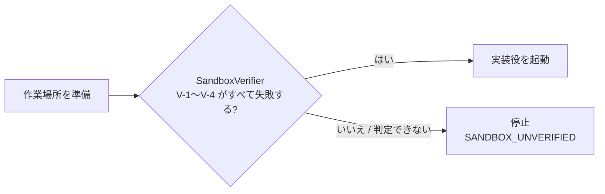

# Harness Engineering — AI エージェントを安全に動かす枠組み

| 項目 | 内容 |
|---|---|
| 状態 | **設計段階**（Phase 0 で設計完了・未実装） |
| 対象 | Phase 6「自律開発ループ」で、実装役の AI エージェントにファイル書き込みとコマンド実行を許す部分 |
| 根拠となる判断 | [ADR-0001](./adr/ADR-0001-autonomous-development-loop.md)（書き込みの例外と条件）/ [ADR-0002](./adr/ADR-0002-claude-agent-sdk.md)（Agent SDK の採用と注意点） |
| 関連 | [Loop Engineering](./loop-engineering.md) / [セキュリティ設計](./security.md) / [アーキテクチャ](./architecture.md) |

> この文書に書いた仕組みは、すべて**設計上のもの**です。コードとしてはまだ実装していません。
> 自律開発ループ自体も**未完成**です。

---

## 1. 考え方

Harness Engineering は、AI が動く「環境・権限・検証手順・停止条件」を整える設計です。本プロジェクトでは次の 3 つを基本方針にしています。

1. **fail closed**：判定できない・異常があるときは、許可せずに拒否する。条件が 1 つでも欠けたら実装役を起動しない
2. **単一の仕組みを安全の根拠にしない**：エージェント SDK の権限設定、OS レベルの隔離、コマンドの許可リスト、hooks、上限、人の承認を重ねる
3. **AI にワークフローの制御権を渡さない**：AI に任せるのは「1 回の実装・修正」の中身だけ。いつ止めるか、次に何をするかはアプリ側が決める

Phase 3（読み取り専用のエージェント）では、エージェントのツールを読み取り専用に限定する方針を維持します。**書き込みを許すのは Phase 6 の実装役だけ**で、その例外には次の条件を付けます。

## 2. 書き込みを許す条件（S-1〜S-10）

Phase 6 で実装役に書き込みとコマンド実行を許すのは、**次のすべてを満たす場合だけ**です。

| # | 条件 | 防ぎたいこと |
|---|---|---|
| S-1 | 対象は架空チケットと、本プロジェクトで作ったダミーリポジトリだけ。実在の組織のリポジトリ・顧客情報・個人情報・秘密情報は扱わない | 実データへの影響 |
| S-2 | 作業場所は、本体リポジトリの外にある実行ごとの使い捨てディレクトリ。本体リポジトリ・ホームディレクトリには書き込ませない | 本体・利用者環境の破壊 |
| S-3 | SDK の権限制御だけを根拠にせず、**OS レベルの隔離**（sandbox またはコンテナ）を必ず組み合わせる | 権限ルールのすり抜け |
| S-4 | 実装役を起動する前に、隔離が実際に効いていることを確認する。確認できなければ起動しない | 「設定したつもり」の隔離 |
| S-5 | 実装役に渡す環境変数は必要最小限にする。ホストの秘密情報（SSH 鍵、クラウドの認証情報など）に届かないようにする | 秘密情報の持ち出し |
| S-6 | 外部ネットワークへの接続は原則禁止。LLM API への通信だけを例外とする | 外部への送信・取得 |
| S-7 | 実行できるコマンドは許可リスト方式（テスト・型チェックなど）。push・PR 作成・デプロイ・破壊的な操作は対象外 | 取り返しのつかない操作 |
| S-8 | 人の承認ポイントを 2 つ置く（開始前・終了後）。成果を自動で本体へ取り込まない | 人の判断を飛ばすこと |
| S-9 | 実行時間・費用・ターン数・修正回数の上限を、アプリ側で必ず強制する | 暴走・費用超過 |
| S-10 | 利用者や本体リポジトリのエージェント設定を、実装役に読み込ませない | 意図しない権限・指示の継承 |

## 3. SandboxVerifier — 起動前の隔離確認

「隔離を設定した」ことではなく、**「禁止した操作が実際に失敗する」こと**を、実装役を起動するたびに確認します。

| # | 実際に試して「失敗すること」を確認する操作 |
|---|---|
| V-1 | 作業場所の外へのファイル書き込み（ツール経由だけでなく、シェルのリダイレクトやファイルコピーによる書き込みも） |
| V-2 | ホームディレクトリにある秘密情報の置き場所（SSH 鍵やクラウドの認証情報など）の読み取り |
| V-3 | 許可していない外部ネットワークへの接続 |
| V-4 | 作業場所の外のファイルの削除 |

- 1 つでも「成功してしまった」場合、または確認そのものができない場合は `SANDBOX_UNVERIFIED` で停止します。
- 隔離が使えない環境で、**隔離なしの実行に切り替えることはしません**。SDK の設定で失敗させ、V-1〜V-4 の確認で裏付けます。
- 隔離の方式（エージェント実行環境の sandbox、コンテナ、またはその両方）は**未決定**です。Phase 6 実装の最初に検証して決めます（[ADR-0001](./adr/ADR-0001-autonomous-development-loop.md) の残課題 T-1〜T-4）。

## 4. 多層の制御

### 4.1 秘密情報の遮断

| 対策 | 内容 |
|---|---|
| 環境変数の最小化 | 実装役に渡す環境変数は、動作に必要なものだけを明示する。SDK の環境変数オプションは全体を置き換えるため、実行中のプロセスの環境変数をそのまま渡さない |
| 設定ファイルの分離 | 利用者・本体リポジトリのエージェント設定を読み込ませない。SDK では `settingSources: []` を必ず指定する（省略すると設定ファイルをすべて読み込むと公式に記載がある） |
| 読み取りの拒否 | 隔離の設定で秘密情報の置き場所の読み取りを拒否し、V-2 で確認する |
| 記録時のマスク | 実行履歴・テスト失敗の要約・差分に秘密情報らしき文字列があればマスクする。API キーや環境変数の値は記録しない |

### 4.2 ネットワーク制限

- 外部ネットワークへの接続は原則禁止します。
- 例外は実装役から LLM API への通信だけです。隔離の中からこれだけを許可する方法は**未確認**です（残課題 T-3）。
- 実装役には Web 取得・Web 検索のツールを使わせません。
- 依存パッケージの取得が必要なテストにしません。ダミーリポジトリは依存を事前に用意しておきます。

### 4.3 コマンドの制御

| 区分 | 内容 |
|---|---|
| 許可（許可リスト） | ダミーリポジトリ用に決めた、テスト実行・型チェックなどのコマンドだけ |
| 拒否 | push・PR 作成・デプロイ・ネットワーク取得系・作業場所の外を対象にした操作・破壊的な操作 |
| 権限モード | すべてを自動で承認するモード（`bypassPermissions` など）は**使わない** |
| 多重化 | 許可リスト・拒否ルール・hooks による拒否を重ねる。hooks の拒否は権限モードに関係なく効くと公式に記載がある |

## 5. 上限と費用管理

### 5.1 上限（初期値）

| 上限 | 初期値 | 強制する場所 |
|---|---|---|
| 修正回数 | 最大 3 回（初回の実装は数えない） | `RetryController` |
| 1 回の実装・修正のターン数 | 30 ターン | SDK の最大ターン数オプション |
| 1 回の実装・修正の時間 | 10 分 | 中断シグナル（`AbortSignal`） |
| 1 回のテスト実行の時間 | 2 分 | `TestRunner` |
| 1 実行全体の時間 | 30 分 | `LoopOrchestrator` |
| 1 実行の費用 | 目標 $1 | `RunBudget`（SDK の費用上限オプションには残り予算を渡す） |
| 1 日の費用 | $3 | `RunBudget` |
| 1 か月の費用 | $10（チケット分析を含むプロジェクト全体の共通予算） | `RunBudget` |

### 5.2 費用の多層防御

1 つの仕組みに頼らず、アプリの内側と提供元の外側の両方で上限を設けます。

| 層 | 仕組み |
|---|---|
| 1 | 入力の上限（文字数など）。LLM に送る前に拒否する |
| 2 | アプリの回数・費用ガード（1 日の回数、同時実行数、月間の推定費用） |
| 3 | 1 回の呼び出しごとの上限（出力トークン、タイムアウト、再試行は 1 回まで） |
| 4 | 提供元の利用上限（本プロジェクト専用のワークスペースに利用上限を設定する。設定は開発者が行う） |
| 5 | アプリ側の費用目標（上の表の 1 実行・1 日・1 か月） |

### 5.3 費用管理の注意点

- 上の値は**アプリ側で止めるための目標**であり、請求額の厳密な上限を保証するものではありません。
- SDK が返す費用は**クライアント側の推定値**で、請求の正本ではありません。推定値と上限の間に余裕を持たせます。
- SDK のセッションを再開した場合、返される費用は累計になります。そのまま足すと二重に数えてしまうため、前回との差分で計上します。
- 外部サービス側の利用上限・請求管理の方法は、実装前に確認します。確認できるまでは、実際の API 呼び出しを伴う実行を始めません。
- Mock の実装役を使った実行・テストは費用 0 で、上限の計算には含めません。

## 6. 人の承認ゲート

| 承認 | タイミング | 確認すること |
|---|---|---|
| 承認① | 実行開始前 | 分析結果・対象のダミーリポジトリ・予算・上限 |
| 承認② | 実行終了後 | 差分・テスト結果・停止理由・費用 |

- 承認がない限り、`ApprovalGate` は先の工程へ進めません。
- MVP では、成果を本体リポジトリへ取り込む機能そのものを作りません。
- アプリの実装役は push・PR 作成・デプロイを行いません。
- 実際の LLM API・Agent SDK を使う実行は、そのたびに開発者の承認を得ます。承認がない間は Mock の実装役で開発・テストします。

## 7. 実行履歴に残すもの・残さないもの

| 区分 | 内容 |
|---|---|
| 残す | 実行 ID、日時、状態の移り変わり、承認の有無、実装・修正ごとのターン数・推定費用・トークン数・時間、テスト結果の要約、停止理由、差分の統計、実装役の種類、モデル名、プロンプトの版 |
| 残さない | API キー・秘密情報・環境変数の値。実装役とのやり取りの全文は既定では残さない（残すかどうかは未決定） |
| 置き場所 | 本体リポジトリの外、または Git 管理外のディレクトリ（`.gitignore` で除外する） |

## 8. 未決定・未確認の事項

| 内容 | 状態 |
|---|---|
| OS レベルの隔離の方式（sandbox / コンテナ / 両方） | 未決定。Phase 6 実装の最初に検証 |
| SDK から隔離を有効にでき、ヘッドレス実行でも実際に効くか | 未確認 |
| 外部ネットワークを禁止したまま LLM API の通信だけを通す方法 | 未確認 |
| ツール単位の制限では検出できない書き込み（リダイレクトなど）を隔離で防げるか | 未確認（V-1 で確認する） |
| 作業場所と実行履歴の既定の置き場所 | 未決定（本体リポジトリの外を推奨） |
