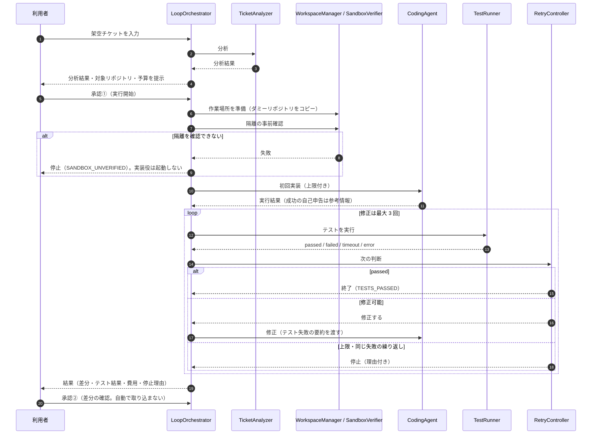
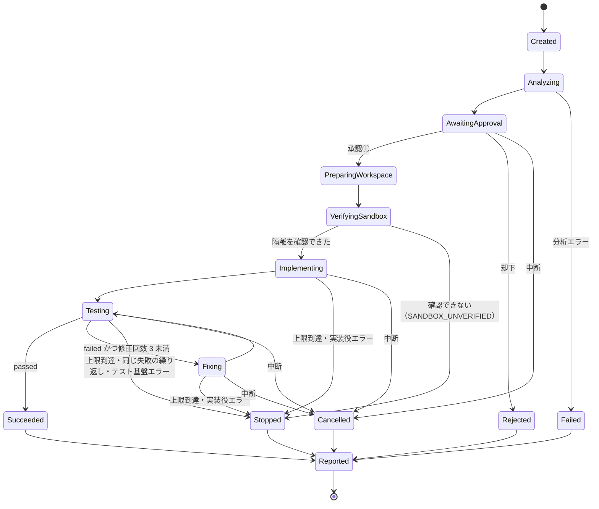

# Loop Engineering — 自律開発ループの構想

| 項目 | 内容 |
|---|---|
| 状態 | **設計段階**（Phase 0 で設計完了・未実装）。**自律開発ループは未完成** |
| 対象 | Phase 6「自律開発ループ（Autonomous Development Loop）」 |
| 根拠となる判断 | [ADR-0001](./adr/ADR-0001-autonomous-development-loop.md) / [ADR-0002](./adr/ADR-0002-claude-agent-sdk.md) |
| 関連 | [Harness Engineering](./harness-engineering.md) / [アーキテクチャ](./architecture.md) / [評価設計](./evaluation.md) / [ロードマップ](./roadmap.md) |

> この文書はループの**設計**です。インターフェースや型は、責務の境界を示すための案であり、実装時に確定します。

---

## 1. 目的と位置付け

- 架空の開発チケットを入力すると、AI が分析から実装・テスト・修正まで進め、人が最終確認する**ローカル自律開発エージェント**を目指します。
- 「コーディングエージェントを自動で動かすだけ」にはしません。**制御・安全性・評価・費用管理を、アプリ側の設計として実装し、説明できること**を狙います。
- Phase 1 のチケット分析（`TicketAnalyzer`）を、ループの最初の工程として再利用します。

## 2. 工程（12 工程）と MVP の範囲

| # | 工程 | 担当（設計上） | MVP |
|---|---|---|---|
| 1 | チケット分析 | `TicketAnalyzer` | ○ |
| 2 | 既存コード・仕様の調査 | 調査用エージェント | × 将来 |
| 3 | 実装計画の作成 | 計画用エージェント | △ 分析結果をそのまま実装役への指示にする |
| 4 | 人による実装承認（承認①） | `ApprovalGate` | ○ |
| 5 | コード実装 | `CodingAgent` | ○ |
| 6 | テスト実行 | `TestRunner` | ○ |
| 7 | テスト失敗時の自動修正 | `RetryController` ＋ `CodingAgent` | ○ 最大 3 回 |
| 8 | AI コードレビュー | レビュー用エージェント | × 将来 |
| 9 | レビュー指摘に基づく修正 | 同上 | × 将来 |
| 10 | 実行結果・差分・費用の整理 | `RunRecorder` | ○ |
| 11 | PR 本文の生成 | 将来（ローカルの Markdown 出力のみ） | × 将来 |
| 12 | 人による最終確認（承認②） | 開発者 | ○ |

**MVP に含めないもの**：AI コードレビューと再修正、PR 本文の生成、GitHub への push・PR 作成、実在のリポジトリの操作・外部サービスへの書き込み、複数の実装役の並列実行。

## 3. エージェント SDK との責務の境界

| 責務 | アプリ側（自作） | エージェント SDK（実装役の内部） |
|---|---|---|
| 工程の順番・状態遷移 | ○ `LoopOrchestrator` | × |
| 1 回の実装・修正の中での、ファイル読み書き・コマンド実行の繰り返し | × | ○ SDK の内部ループ |
| テストの合否判定 | ○ `TestRunner`（自己申告は使わない） | × |
| 修正するか止めるか | ○ `RetryController` | × |
| 費用・時間・ターン数の上限 | ○ 実行全体を管理し、1 回ごとの上限を SDK に渡す | ○ 渡された上限で止まる |
| 中断 | ○ 中断シグナルを渡す | ○ 中断を受けて止まる |
| ツールの許可・拒否 | ○ 許可リスト・判定関数・hooks を設定 | ○ 設定に従って判定 |
| OS レベルの隔離 | ○ 事前確認し、効かなければ起動しない | 設定によっては sandbox を使う（効くかは未確認） |
| 人の承認 | ○ `ApprovalGate` | × |
| 実行履歴 | ○ `RunRecorder` | 結果（ターン数・推定費用など）を返す |

**原則：AI にワークフロー全体の制御権を渡さない。** SDK の内部ループは「1 回の実装」または「1 回の修正」の中に閉じ込め、その外側はすべてアプリが決めます。

## 4. ワークフロー（シーケンス）



## 5. 状態遷移（RunState）



- 状態は `RunState` という 1 つの型で表し、遷移は `LoopOrchestrator` の中の**遷移表でだけ**許可します。表にない遷移は例外にします。
- どの終了状態（`Succeeded` / `Stopped` / `Cancelled` / `Failed` / `Rejected`）でも、必ず `Reported` を通って実行履歴と停止理由を残します。

## 6. 停止理由（StopReason）

止まった理由を 12 種類に分けて記録し、「なぜ止まったか」を後から評価できるようにします。

```ts
// 設計案（実装時に確定する）
type StopReason =
  | "TESTS_PASSED" | "MAX_FIX_ATTEMPTS" | "REPEATED_FAILURE"
  | "BUDGET_EXCEEDED" | "TIMEOUT" | "MAX_TURNS"
  | "USER_CANCELLED" | "APPROVAL_REJECTED"
  | "SANDBOX_UNVERIFIED" | "AGENT_ERROR" | "TEST_INFRA_ERROR" | "ANALYSIS_ERROR";
```

| 区分 | 停止理由 | 意味 |
|---|---|---|
| 成功 | `TESTS_PASSED` | テストが `passed` になった |
| 上限 | `MAX_FIX_ATTEMPTS` | 修正回数の上限（3 回）に達した |
| | `BUDGET_EXCEEDED` | 費用の上限に達した、または残り予算が次の 1 回分に満たない |
| | `TIMEOUT` | 時間の上限に達した |
| | `MAX_TURNS` | ターン数の上限に達した |
| 改善の見込みなし | `REPEATED_FAILURE` | 同じテストが同じ理由で 2 回続けて失敗した |
| 人の判断 | `USER_CANCELLED` | 利用者が中断した |
| | `APPROVAL_REJECTED` | 承認①で却下された |
| 安全・異常 | `SANDBOX_UNVERIFIED` | 隔離を確認できなかった |
| | `AGENT_ERROR` | 実装役でエラーが起きた |
| | `TEST_INFRA_ERROR` | テストを起動できない・作業場所が壊れているなど、修正では直らない異常 |
| | `ANALYSIS_ERROR` | チケット分析でエラーが起きた |

## 7. テストの独立判定（TestRunner）

- テストの合否は、`TestRunner` が許可されたテストコマンドを**実際に実行し、終了コードと結果で判定**します。
- 実装役の「テストが通った」という**自己申告は合否の根拠にしません**（参考情報として記録するだけ）。
- 結果は 5 種類で、**`passed` 以外はすべて不合格**です。

```ts
// 設計案
type TestResult = {
  outcome: "passed" | "failed" | "timeout" | "error" | "not_run";
  exitCode: number | null;
  durationMs: number;
  summary: string; // 失敗したテスト名と要点（長さ上限あり）
};
```

## 8. 修正ループの規則

| 項目 | ルール |
|---|---|
| 回数の数え方 | 初回の実装は数えない。テスト失敗後の修正を 1〜3 回目として数える（最大 3 回） |
| 修正に渡す情報 | テスト失敗の要約（失敗したテスト名・期待値と実際の値・エラーの要点）。長さに上限を設け、秘密情報らしき文字列はマスクする |
| 同じ失敗の繰り返し | 直前と同じテストが同じ理由で 2 回続けて失敗したら、修正回数が残っていても止める（`REPEATED_FAILURE`） |
| 予算の残り | 次の修正の前に、残り予算が 1 回分の上限を下回っていれば止める（`BUDGET_EXCEEDED`） |
| テストの判定 | `passed` だけを成功とする。`not_run`・`error`・`timeout` は成功にしない |
| テスト基盤の異常 | 修正では直らない異常は、修正せずに止める（`TEST_INFRA_ERROR`） |
| 修正の継続方法 | 前回の SDK セッションを再開するか、毎回新しく始めるかは**未決定**（評価で比較して決める） |

## 9. 主要な部品（設計）

すべて**設計段階**で、未実装です。

| 部品 | 責務 |
|---|---|
| `LoopOrchestrator` | 状態遷移・上限の強制・中断・各部品の呼び出し順 |
| `TicketAnalyzer` | チケット分析（Phase 1 の部品を再利用する予定） |
| `ApprovalGate` | 承認①②の受付。承認がない限り先へ進めない |
| `RunBudget` | 実行・日・月の費用、実行時間、ターン数の残りを管理 |
| `WorkspaceManager` | ダミーリポジトリのひな形から使い捨ての作業場所を作り、差分を取り、後片付けする |
| `SandboxVerifier` | 隔離が効いているかを、実装役の起動前に確認する（[Harness Engineering](./harness-engineering.md)） |
| `CodingAgent` | 1 回の実装・修正を行う。SDK 版と Mock 版を差し替えられるようにする |
| `TestRunner` | 許可されたテストコマンドを実行し、終了コードで判定する |
| `RetryController` | テスト結果・回数・予算から「修正する / 止める」を決める |
| `RunRecorder` | 状態の移り変わり・回数・推定費用・テスト結果・差分を保存する |

## 10. 将来の拡張（構想）

| 段階 | 内容 |
|---|---|
| MVP の次 | AI コードレビュー（別のエージェントが差分を読み取り専用で確認）と、指摘に基づく修正（修正回数の上限は別枠で管理） |
| MVP の次 | PR 本文の生成（ローカルの Markdown 出力のみ。push・PR 作成はしない） |
| その後 | 既存コード・仕様の調査工程と、AI による実装計画の作成 |
| その後 | CLI 版の実装役と SDK 版の比較評価 |
| その後 | 複数の実行の並列化（隔離と予算を実行単位で分ける） |

## 11. 決定事項と未決定事項

### 決定事項

| ID | 決定内容 | 理由 |
|---|---|---|
| LP-01 | 工程全体は自作の `LoopOrchestrator` が状態遷移表で管理する | AI にワークフローの制御権を渡さないため |
| LP-02 | テストの合否は `TestRunner` の実行結果だけで判定し、`passed` 以外は不合格 | 実装役の自己申告に頼らないため |
| LP-03 | 修正は最大 3 回。初回の実装とは別に数える | 費用と時間の上限を明確にするため |
| LP-04 | 隔離を確認できない場合は実装役を起動しない | 権限設定だけを安全の根拠にしないため |
| LP-05 | 実装役は `CodingAgent` で抽象化し、SDK 版と Mock 版を MVP で用意する | 差し替えと、費用 0 のテストのため |
| LP-06 | 費用上限は 1 実行 $1（目標）/ 1 日 $3 / 1 か月 $10（全体共通） | 請求の上限保証ではなく、アプリ側で止める目標 |
| LP-07 | 承認は開始前と終了後の 2 回。成果を本体へ自動で取り込まない | 人が最終判断を持つため |

### 未決定事項

| ID | 内容 | 推奨案 |
|---|---|---|
| LP-U1 | OS レベルの隔離の方式 | 隔離の確認タスクの結果で判断 |
| LP-U2 | 作業場所と実行履歴の置き場所 | 本体リポジトリの外の専用ディレクトリ。中に置く場合は Git 管理外 |
| LP-U3 | 実装役に使うモデル | 設定で切り替え、評価で決める |
| LP-U4 | インターフェースの最終形 | 本文の案から開始 |
| LP-U5 | 修正時に SDK セッションを再開するか、新しく始めるか | 評価で比較 |
| LP-U6 | 実装役とのやり取りの全文を記録に残すか | 既定は残さず、デバッグ時だけ一時的に残す |
| LP-U7 | ダミーリポジトリの題材と数 | 小さな TypeScript ライブラリ 1〜2 個（テスト付き） |
| LP-U8 | 結果表示を CLI だけにするか、画面も作るか | MVP は CLI ＋ 簡単な結果画面 |
