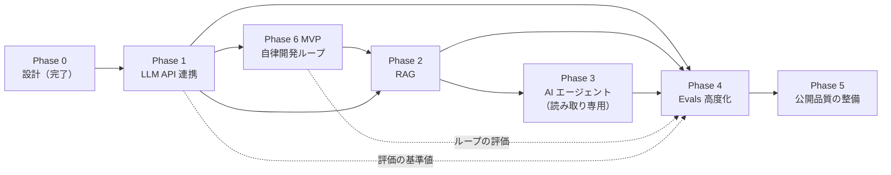

# ロードマップ（Roadmap）

> **状態: 設計段階（Phase 0 で設計完了・未実装）**
> 完了しているのは Phase 0（設計）だけです。Phase 1 以降はすべて未着手で、工数・スケジュールは目安です。

| 項目 | 内容 |
|---|---|
| 関連 | [README](../README.md) / [要件定義](./requirements.md) / [評価計画](./evaluation.md) / [Loop Engineering](./loop-engineering.md) / [Agentic Workflow](./agentic-workflow.md) |

> 工数は「個人開発・AI コーディングエージェント併用・学習時間込み」の概算です。確定値ではありません。

---

## 1. 全体像

- **推奨の実施順: Phase 1 → 6（MVP）→ 2 → 3 → 4 → 5**
- Phase 6（自律開発ループ）の着手条件は **Phase 1 の中核機能が完成していること**だけです。Phase 2〜5 の完了は条件にしません（[ADR-0001](./adr/ADR-0001-autonomous-development-loop.md)）
- Phase 6 MVP に必要な最小の評価・テストは、Phase 4 を待たずに Phase 6 の中で作ります
- Phase 3 は読み取り専用のエージェント、Phase 6 は隔離した作業場所の中で書き込むエージェントとして区別します
- **設計資料は Phase 0 完了時点で先行公開しています。** Phase 5 は「公開」そのものではなく、公開品質の整備（起動手順、デモ、評価結果の掲載）を指します

実線の矢印は依存関係です。Phase 2 が実際に依存しているのは Phase 1 だけで、Phase 6 → Phase 2 の矢印は推奨の実施順を表します。

| Phase | 状態 | 概算工数 | 依存関係 | 主な学習テーマ |
|---|---|---|---|---|
| 0 設計 | ✅ 完了 | — | なし | 要件整理・技術選定・安全設計 |
| 1 LLM API 連携 | 📝 未着手 | 40〜60 時間 | Phase 0 | 構造化出力・型安全・評価の基礎 |
| 6 自律開発ループ（MVP） | 📝 未着手 | 35〜48 時間 | **Phase 1 の中核機能だけ** | 状態遷移・独立したテスト判定・修正ループ・OS レベルの隔離・費用上限 |
| 2 RAG | 📝 未着手 | 40〜60 時間 | Phase 1 | 分割・埋め込み・検索・出典 |
| 3 AI エージェント | 📝 未着手 | 40〜60 時間 | Phase 2（仕様検索をツール化） | ツール呼び出し・多段処理・停止条件 |
| 4 Evals 高度化 | 📝 未着手 | 25〜40 時間 | Phase 1〜3（Phase 6 MVP があればその評価も対象） | LLM 採点・人手評価・改善サイクル |
| 5 公開品質の整備 | 📝 未着手 | 15〜25 時間 | Phase 1〜4（Phase 6 MVP があれば含める） | 起動手順・デモ・評価結果の掲載 |
| 6 自律開発ループ（MVP の後の拡張） | 💭 構想 | 20〜30 時間 | Phase 6 MVP | AI コードレビュー・指摘に基づく修正・PR 本文の生成 |

**最初の実装予定**: Mock LLM（API キー不要・費用 0）を使った Phase 1 の試作から始めます。

**最小公開ライン**: Phase 1 ＋ README・評価の基準値だけでもポートフォリオとして成立させます。後続の Phase が遅れても、Phase ごとに「公開できる状態」で区切ります。

## 2. Phase 詳細

### Phase 1: LLM API 連携によるチケット分析（未着手）

| 項目 | 内容 |
|---|---|
| 目的 | 1 回の LLM 呼び出しで 6 項目を型安全な構造化データとして得る仕組みと、その品質を測る最小の評価基盤を作る |
| 依存 | Phase 0 |
| 概算工数 | 40〜60 時間 |

**予定する作業**

| # | 作業 | 概算 |
|---|---|---|
| 1-1 | プロジェクトの雛形（Next.js・TypeScript strict・ESLint・Vitest・Playwright・pnpm） | 3〜4h |
| 1-2 | ドメインスキーマ（`TicketInput` / `AnalysisResult`）と JSON Schema 変換 | 3〜4h |
| 1-3 | `LlmClient` インターフェース・`ClaudeLlmClient`・`MockLlmClient` | 5〜7h |
| 1-4 | `PromptBuilder`（プロンプト v1 をファイル管理）・インジェクション対策の区切り | 3〜5h |
| 1-5 | `TicketAnalyzer`（検証・再試行 1 回・メタ情報ログ） | 4〜6h |
| 1-6 | `UsageGuard`（入力上限・1 日の回数・同時実行・推定費用） | 4〜6h |
| 1-7 | 分析 API（`POST /api/analyze`）とエラー変換 | 2〜3h |
| 1-8 | 分析画面（入力・サンプル選択・6 セクション表示・コピー） | 6〜8h |
| 1-9 | 架空サンプルチケット 5 件以上・評価データセット 20 件 | 3〜5h |
| 1-10 | 評価 CLI（層①②の自動採点・結果ファイル出力）と基準値の記録 | 5〜7h |
| 1-11 | セキュリティ（`server-only`、バンドル検査テスト、秘密情報スキャン） | 2〜3h |

**対象外**: 公開デモ、ログイン、分析履歴の DB 保存、ストリーミング表示、RAG、エージェント

**完了条件**

- [ ] 実 LLM モードで 6 項目が表示され、Mock LLM モードでは API キーなしで同じ画面が動く
- [ ] 評価データセット 20 件でスキーマ適合率（再試行込み）98% 以上
- [ ] 単体テストと E2E テストが Mock で全件成功
- [ ] ビルド成果物に API キー関連の文字列がないことをテストで確認
- [ ] 上限超過時に分析が拒否されることをテストで確認
- [ ] 基準値レポート（スコア・トークン数・推定費用・応答時間）がリポジトリにある
- [ ] 秘密情報スキャンの検出 0 件

### Phase 6: 自律開発ループ（MVP・未着手）

| 項目 | 内容 |
|---|---|
| 目的 | 架空チケットから、隔離した作業場所での実装 → 独立したテスト → 最大 3 回の修正までを、アプリ側の制御で自動実行する |
| 依存 | Phase 1 の中核機能（`LlmClient`・`TicketAnalyzer`・`UsageGuard`・評価 CLI の最小版） |
| 着手条件 | ①Phase 1 の中核機能が完成している ②提供元側の利用上限の効き方を開発者が確認済み（未確認の間は Mock の実装役だけで進める）③開発者が Phase の移行を承認している |
| 概算工数 | MVP 35〜48 時間 ／ MVP の後の拡張 20〜30 時間 |
| 設計 | [Loop Engineering](./loop-engineering.md) / [Harness Engineering](./harness-engineering.md) |

**予定する作業**

| # | 作業 | 概算 |
|---|---|---|
| 6-1 | 隔離の確認（SDK の sandbox が効くか・方式の比較・`SandboxVerifier` の確認項目 V-1〜V-4）。**最初に行う** | 4〜6h |
| 6-2 | ダミーリポジトリのひな形と、架空チケット 5〜10 件 | 3〜4h |
| 6-3 | 作業場所の準備・差分取得 | 2〜3h |
| 6-4 | `CodingAgent` インターフェース・Agent SDK 版・Mock 版 | 6〜8h |
| 6-5 | `LoopOrchestrator`（状態遷移表・上限・中断・承認） | 6〜8h |
| 6-6 | `TestRunner`・`RetryController` | 4〜5h |
| 6-7 | `RunBudget`（`UsageGuard` の拡張）・`RunRecorder` | 3〜4h |
| 6-8 | 結果表示（CLI ＋ 簡単な結果画面） | 3〜4h |
| 6-9 | 単体テスト（Mock で状態遷移・停止条件を網羅）と最小限の評価 | 4〜6h |

**完了条件**

- [ ] 隔離の確認項目 V-1〜V-4 がすべて「失敗する（遮断される）」ことを確認し、記録している。確認できない場合は実装役を起動しないことをテストで確認
- [ ] Mock の実装役で、すべての停止理由（`StopReason`）に到達するテストが成功
- [ ] テストの合否が `TestRunner` の結果だけで決まり、実装役の自己申告で成功にならないことをテストで確認
- [ ] 修正が最大 3 回で止まり、初回の実装と別に数えられていることをテストで確認
- [ ] 実 API を使った実行で、1 実行の推定費用が上限内に収まり、実行履歴・差分・停止理由が表示される（実 API の実行は開発者の承認後）
- [ ] 架空チケット 5〜10 件での評価結果（実装成功率・修正回数・費用・停止理由）が記録されている

**MVP の後の拡張（範囲外）**: AI コードレビュー、指摘に基づく修正、PR 本文の生成（ローカル出力のみ）。push・PR 作成・外部サービス連携は引き続き対象外です。

### Phase 2: RAG による架空仕様書の検索（未着手）

| 項目 | 内容 |
|---|---|
| 目的 | 架空サービスの仕様書を根拠として検索し、影響範囲・不明点を出典付きで出せるようにする |
| 成果物（予定） | 架空仕様書 10〜30 本、取り込み CLI、`VectorStore` インターフェースと実装、出典付き表示、RAG あり／なしの比較レポート |
| 完了条件 | ①期待する仕様書が検索上位 5 件に入る割合を測定・記録 ②RAG ありで影響範囲の再現率が基準値より改善（改善しなければ原因分析を記録）③存在しない出典を返したら検証で弾かれる ④埋め込みの費用がガードで管理されている |

### Phase 3: AI エージェントによる複数処理の連携（未着手）

| 項目 | 内容 |
|---|---|
| 目的 | 分析を複数の専門ステップに分け、ツール呼び出しで連携させる。単一呼び出しとの得失を数値で示す |
| 成果物（予定） | 進行役（Orchestrator）と各ステップ、読み取り専用ツール、実行経過の表示、方式比較レポート（品質・時間・費用） |
| 完了条件 | ①ステップ数・トークン・時間の上限で必ず停止することをテストで確認 ②実行経過が UI で見える ③単一呼び出し方式との比較レポートがある（エージェントが劣る結果でも、そのこと自体を記録する） |

### Phase 4: Evals による回答品質の評価・改善（未着手）

| 項目 | 内容 |
|---|---|
| 目的 | 評価を高度化し、「改善の効果を数値で示せる」状態にする |
| 成果物（予定） | データセット v2（50〜100 件）、LLM 採点（LLM-as-a-judge）、人手採点との一致度、改善前後レポート |
| 完了条件 | ①LLM 採点と人手採点（20 件程度）の一致度を記録 ②少なくとも 1 回、仮説 → 変更 → 評価 → 採否判断の改善サイクルを記録 ③評価 1 回あたりの費用を記録 |

### Phase 5: 公開品質の整備（未着手）

> 設計資料は Phase 0 完了時点で先行公開しています。Phase 5 は、アプリを第三者が短時間で理解・再現できる状態に整える段階です。

| 項目 | 内容 |
|---|---|
| 目的 | 起動手順、デモ、評価結果を掲載し、clone して Mock LLM モードで起動できる状態にする |
| 依存 | Phase 1〜4（最小公開ラインは Phase 1） |
| 概算工数 | 15〜25 時間 |
| 成果物（予定） | README の更新（構成図・設計判断・評価結果・費用・起動手順）、デモ動画またはスクリーンショット、（任意）アクセス制限付きの公開デモ |
| 完了条件 | ①[セキュリティ設計](./security.md) の公開前チェックリストをすべて満たす ②clone して Mock LLM モードで起動できる ③公開範囲の変更・デモのデプロイは開発者本人が行う |

## 3. 決定事項・未決定事項

### 決定事項

| ID | 決定内容 | 判断理由 |
|---|---|---|
| RM-01 | 評価は Phase 1 から始める。Phase 2〜5 は番号順に進める | RAG・エージェントはそれぞれ前の Phase の上に乗るため |
| RM-02 | 各 Phase の完了条件に「比較レポート」を入れる | 「作った」ではなく「効果を測った」を成果にするため |
| RM-03 | Phase 1 だけでも公開できる状態を目指す | 後続が遅れてもポートフォリオとして成立させるため |
| RM-04 | Phase 6 を追加し、着手条件は Phase 1 の中核機能の完成だけとする。推奨の実施順は 1 → 6（MVP）→ 2 → 3 → 4 → 5 | 最終目標（自律開発ループ）に早く着手しつつ、既存の Phase の決定を壊さないため（[ADR-0001](./adr/ADR-0001-autonomous-development-loop.md)） |
| RM-05 | Phase 6 の最初の作業は隔離の確認（6-1）とする | 隔離が効かなければ実装役を起動できず、以降の作業が成り立たないため |

### 未決定事項

| ID | 内容 | 決める時期 |
|---|---|---|
| RM-U1 | 週あたりの作業時間（工数見積もりの前提） | 開発者が決める |
| RM-U3 | Phase 2 と Phase 4 の一部（データセットの拡充）を並行するか | Phase 2 開始時 |
| RM-U4 | Phase 6 の MVP の後の拡張（AI レビュー・PR 本文生成）をいつ行うか | Phase 6 MVP 完了時 |
| RM-U5 | 最小公開ラインに Phase 6 MVP を含めるか | Phase 6 MVP 完了時 |
