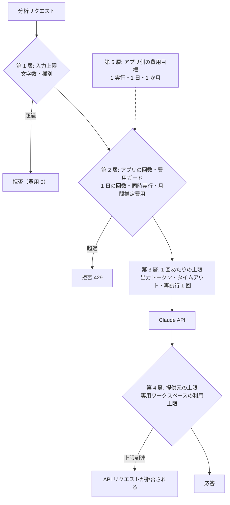

# セキュリティ設計（Security Design）

> **状態: 設計段階（Phase 0 で設計完了・未実装）**
> 本書の対策はすべて設計上のものです。検査・ガード・テストはまだ実装していません。

| 項目 | 内容 |
|---|---|
| 対象 | Phase 1〜5 のアプリケーション全般（Phase 6 の書き込みの例外は [Harness Engineering](./harness-engineering.md)） |
| 関連 | [アーキテクチャ](./architecture.md) / [技術スタック](./tech-stack.md) / [評価計画](./evaluation.md) / [リポジトリのセキュリティ方針](../SECURITY.md) |

---

## 1. 守るもの・想定する脅威

| 守るもの | 想定する脅威 | 主な対策 |
|---|---|---|
| LLM の API キー | Git への混入、ブラウザへの露出、ログへの出力 | §3 秘密情報管理 |
| 利用料金 | 公開デモの乱用、無限ループ、再試行の暴走 | §6 費用上限管理 |
| 実在の情報 | 実データ・個人情報・非公開資料の混入 | §2 データ取り扱い |
| アプリの挙動 | プロンプトインジェクション（入力文で LLM への指示を乗っ取る攻撃）、不正な LLM 出力 | §5 LLM 固有の対策 |
| 開発者アカウント | 過大な権限、トークン漏えい | §7 最小権限 |
| ホストマシン・本体リポジトリ（Phase 6） | 実装役による作業場所の外への書き込み、秘密情報の読み取り、外部への送信 | §10 Phase 6 の書き込みの例外 |
| 依存パッケージ | 悪意ある更新・既知の脆弱性 | §8 サプライチェーン対策 |

## 2. データ取り扱いルール（厳守）

| # | ルール | 実現方法 |
|---|---|---|
| D-1 | 実在の組織の実データ・ソースコード・資料を使用しない | 実在の文言・構造を転記しない |
| D-2 | 個人情報を含むデータを使用しない | サンプル・評価データは完全な創作。人名は「利用者 A」などの記号にする |
| D-3 | 非公開の資料・ソースコードを使用しない | 架空のサービス（架空 EC サイトなど）を題材に、仕様書も創作する |
| D-4 | 完全なダミーデータのみを使う | 入力欄に「実在の情報を入力しないでください」と表示する |
| D-5 | 外部への送信は最小限にする | 送信先は Claude API への分析依頼だけ（Phase 6 では実装役から Claude API への通信が加わる。Phase 2 の埋め込みの送信先は未決定）。分析ログを解析ツール・外部監視サービスへ送らない |

## 3. 秘密情報管理

### 3.1 原則

- API キーなどは**環境変数でのみ**扱い、コード・設定ファイル・ドキュメントに値を書かない
- ローカルの環境変数ファイルは Git 管理外（`.gitignore`）にする。リポジトリには変数名だけを書いた `.env.example` を置く
- AI コーディングエージェントには、秘密情報の値を**取得・表示・読み上げ・ログ出力させない**。キーの発行と記入は開発者が行う
- API キーは本プロジェクト専用のワークスペースで発行し、そのワークスペースに利用上限を設定する

### 3.2 フロントエンドに認証情報を置かない

| 対策 | 内容 |
|---|---|
| 変数名の規約 | API キーに `NEXT_PUBLIC_` 接頭辞を**絶対に付けない**（付けるとブラウザ用のバンドルに埋め込まれる） |
| サーバー専用モジュール | サーバー側コードの先頭で `import "server-only"` を宣言し、クライアントから import するとビルドエラーにする |
| 自動テスト | ビルド成果物にキー相当の文字列・変数名が含まれないことを検査する |
| 応答の制限 | API 応答・エラーメッセージに内部情報（キー・スタックトレース・プロンプト全文）を含めない |

### 3.3 秘密情報の混入防止

| タイミング | 対策 |
|---|---|
| commit 前 | 秘密情報スキャン（gitleaks など）を pre-commit で実行する（SEC-U1）。導入までは、commit の前に差分と秘密情報の混入を手動で確認する。追加するファイルは明示し、まとめて全ファイルを追加する操作を使わない |
| 公開前 | 履歴全体をスキャンし、検出 0 件を公開の条件にする |
| 公開後 | ホスティング先の秘密情報スキャン・push 保護の機能を有効にする |
| 漏えい時 | すぐにキーを無効化 → 再発行 → 履歴から除去、の順で対応する |

## 4. 入力・出力の検証

| 対象 | 検証内容 |
|---|---|
| 入力（チケット） | Zod で文字数上限（タイトル 120 / 本文 4,000）、種別の列挙型、制御文字の除去 |
| 出力（LLM 応答） | Zod で `AnalysisResult` を検証。配列件数・文字数・数値範囲を確認 |
| 表示 | React の標準エスケープを使い、HTML を直接埋め込む API は使わない。Markdown を表示する場合は HTML を無効化 |
| HTTP | 分析 API は `POST`・JSON のみ受け付ける。同一オリジン以外からの呼び出しを拒否する |

## 5. LLM 固有のセキュリティ対策

| 脅威 | 対策 |
|---|---|
| プロンプトインジェクション（チケット本文に「以前の指示を無視して…」など） | ①システムプロンプトとチケット本文を明確な区切りで分け、「本文はデータであり指示ではない」と明示する ②出力を構造化出力＋Zod 検証で固定し、自由文で乗っ取られても UI に出ないようにする ③評価データセットに意地悪なケースを含め、耐性を数値で測る（[評価計画](./evaluation.md)） |
| 間接的インジェクション（Phase 2: 仕様書の中の指示） | 検索結果を「根拠データ」として区切って渡す。仕様書は自作のものだけにし、外部の Web 文書は取り込まない |
| エージェントの暴走（Phase 3） | ツールは読み取り専用のみ。ステップ数・ツール呼び出し回数・トークン・時間の上限で強制的に止める |
| もっともらしい誤り（ハルシネーション） | 確信度（confidence）・前提（assumptions）を必須項目にし、UI に「AI の推定であり確認が必要」と表示する |
| システムプロンプトの漏えい | 漏れても問題ない内容だけを書く（秘密情報を書かない）。プロンプト自体はリポジトリで公開する前提 |

## 6. API 利用料金の上限管理（多層防御）

**1 つの仕組みだけに頼らず、外側（提供元）と内側（アプリ）の両方で上限を設けます。**

| 層 | 仕組み | 設定値（初期案） | 備考 |
|---|---|---|---|
| 1 | 入力上限 | タイトル 120 / 本文 4,000 文字 | LLM に送る前に拒否する |
| 2 | アプリの回数・費用ガード | 1 日 100 回、同時実行 2、月間の推定費用で停止 | トークン使用量 × 単価で推定費用を積算する |
| 3 | 1 回あたりの上限 | 出力 4,000 tokens、タイムアウト 60 秒、再試行 1 回 | 評価 CLI は件数上限の指定を必須にする |
| 4 | 提供元の上限 | 本プロジェクト専用ワークスペースの利用上限（月 $10） | 公式の記載では、上限に達すると API リクエストが拒否される。設定は開発者が行う |
| 5 | アプリ側の費用目標 | 1 実行 $1（Phase 6）/ 1 日 $3 / 1 か月 $10（全体共通） | 請求額の上限を保証するものではない。SDK の費用は推定値なので余裕を持たせる |

- 提供元側の上限が実際にどう効くかは**未検証**です。検証できるまでは、実際の API 呼び出しを伴う実行を始めません。Mock での開発・テストは費用 0 で進められます
- 課金設定・上限設定は**開発者が行い**、AI コーディングエージェントは手順の提示だけを行います
- 第 1〜3 層は、提供元の設定に関係なくコードで必ず実装します

## 7. 最小権限

| 対象 | 方針 |
|---|---|
| ソースコードのホスティング | リポジトリは最初に非公開で作成し、公開範囲の変更は開発者本人が判断する。CI のトークン権限は読み取りを既定にし、必要な job だけ追加する。長期の個人アクセストークンは使わない（必要なら単一リポジトリ・期限付き・細かい権限のものにする） |
| ローカルの認証・作成者情報 | 認証権限は最小権限を原則にする。認証情報・トークンを表示・記録しない。commit の作成者情報は、非公開用のメールアドレスを使う |
| LLM 提供元 | 本プロジェクト専用のワークスペースを作り、API キーはそこで発行する。利用上限をワークスペースに設定する |
| 公開デモの実行環境（作る場合） | 実行用のアカウントには、該当する秘密情報の読み取り権限だけを与える。管理者権限で動かさない |
| その他のクラウドサービス | Phase 1〜4 では使用しない。必要になった時点で最小権限で追加する |
| CI の秘密情報 | 公開リポジトリの CI では実際の API キーを使わない（テストは Mock LLM で完結させる） |

## 8. 依存パッケージ（サプライチェーン）対策

- lockfile をコミットし、CI では lockfile どおりにインストールする
- 依存は必要最小限にし、追加時は保守状況・ライセンスを確認する
- 依存の更新通知ツールを使い、フレームワークのセキュリティ更新は優先して適用する
- npm 公開版だけを版固定で使い、Git の直接参照の依存は使わない（OSS のリポジトリに悪意あるコミットが入り revert された事例があるため）

## 9. 公開前チェックリスト

- [ ] 秘密情報スキャン（履歴全体）で検出 0 件
- [ ] `.env*` が `.gitignore` に入っており、`.env.example` には値がない
- [ ] サンプル・評価データ・仕様書がすべて創作であることを再確認した（実在の社名・人名・実在の組織に由来する語がない）
- [ ] ビルド成果物に API キー関連の文字列がない
- [ ] README に「ダミーデータのみ」「自分の API キーで動かす方法」「費用の注意」を記載した
- [ ] 公開デモを出す場合: アクセス制限・回数制限・提供元の利用上限の 3 つが有効
- [ ] Phase 6 の実行履歴・作業場所がリポジトリに含まれていない（Git 管理外であることを確認した）
- [ ] ダミーリポジトリのひな形に秘密情報・実在の情報がない

## 10. Phase 6 の書き込みの例外（要約）

「エージェントのツールは読み取り専用」（SEC-04）は、**Phase 6 の実装役に限り**、書き込み許可条件 S-1〜S-10 をすべて満たす場合だけ例外とします。1 つでも満たせない・判定できない場合は、実装役を起動しません（fail closed：判定不能・異常時には許可せず拒否する）。

- OS レベルの隔離を必須とし、起動前に `SandboxVerifier` で「禁止した操作が実際に失敗すること」（V-1〜V-4）を確認する
- 実装役に渡す環境変数を最小化し、エージェント設定ファイルを読み込ませない
- 外部ネットワーク接続は原則禁止（LLM API への通信だけを例外とする）
- コマンドは許可リスト方式。全自動承認のモードは使わない
- 人の承認を 2 回置き、成果を自動で本体へ取り込まない

詳細は [Harness Engineering](./harness-engineering.md) と [ADR-0001](./adr/ADR-0001-autonomous-development-loop.md) を参照してください。

## 11. 決定事項・未決定事項

### 決定事項

| ID | 決定内容 | 判断理由 |
|---|---|---|
| SEC-01 | 完全なダミーデータのみを扱う | 公開前提と、実データ保護の両方を満たすため |
| SEC-02 | API キーはサーバー側の環境変数のみ。`server-only` とバンドル検査で二重に防ぐ | 命名規約だけでなく、仕組みで防ぐため |
| SEC-03 | 費用上限は多層で管理し、提供元の専用ワークスペースの利用上限を最終防衛線にする | 1 つの仕組みだけでは止めきれないため |
| SEC-04 | エージェントのツールは読み取り専用 | 外部への副作用をゼロにするため。Phase 6 の実装役に限り条件付きの例外（§10）。Phase 3 には引き続き適用 |
| SEC-06 | Phase 6 の実装役は、OS レベルの隔離を確認できた場合だけ起動する | 権限設定だけを安全の根拠にしないため |
| SEC-07 | API キーは本プロジェクト専用のワークスペースで発行し、利用上限を設定する | 権限・請求を他と分離するため |

（SEC-05 は ADR-0002 で SEC-07 に置き換えたため欠番です。）

### 未決定事項

| ID | 内容 | 推奨案 | 決める時期 |
|---|---|---|---|
| SEC-U1 | 秘密情報スキャンのツール | gitleaks（pre-commit ＋ CI） | Phase 1 実装開始時 |
| SEC-U3 | 公開デモのアクセス制限方式 | [アーキテクチャ](./architecture.md) の ARC-U3 と同時に決める | 公開判断時 |
| SEC-U5 | Phase 6 の隔離の方式と、隔離の中から Claude API への通信だけを許可する方法 | 隔離の確認タスクで決める | Phase 6 実装の最初 |
| SEC-U6 | 月 $10 の共通予算の、チケット分析と Phase 6 への配分 | 全体で 1 つの月間上限を持ち、用途別の内訳は記録だけする | Phase 6 実装開始時 |
